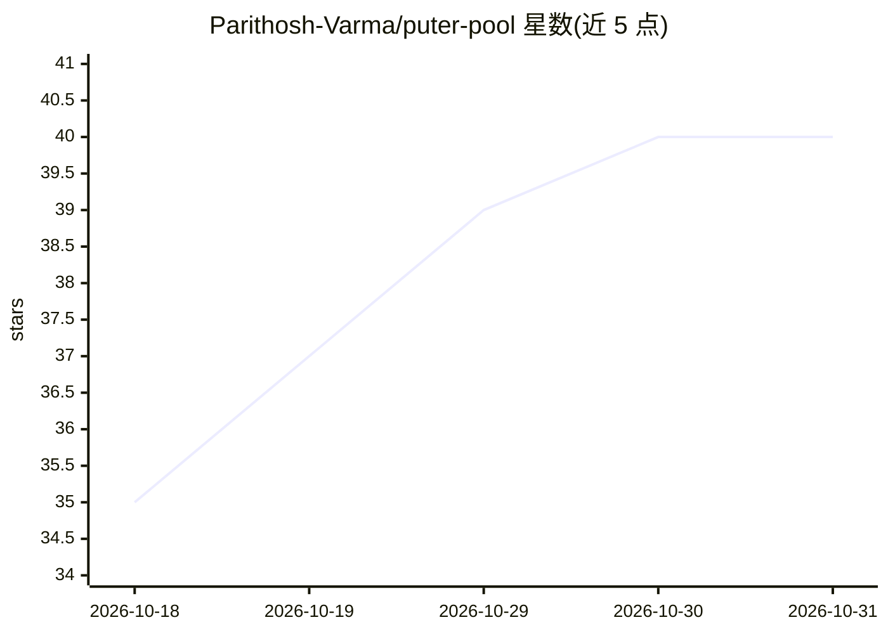

# Parithosh-Varma/puter-pool

⭐ 40 · TypeScript · EPL-2.0 · 推送 2026-10-17 · [GitHub](https://github.com/Parithosh-Varma/puter-pool) · [官网](https://puterpool.pages.dev/) · 个人维护

**汇聚多个 Puter 免费账户额度的本地 AI API 代理池**

本地运行的代理服务：将用户自有的多个 Puter 免费账户的每日 AI 额度合并为一个端点，提供 OpenAI 兼容（/v1/chat/completions）与 Anthropic 兼容（/v1/messages）接口，支持 SSE 流式输出与 400+ 模型（Claude、GPT、Gemini、DeepSeek 等）。调度器支持轮询/最少使用策略，跨账户自动故障转移，经 HealthChecker 停用耗尽或出错的账户；数据存本地 SQLite，令牌不离开本机。Node.js 20+ 运行，可 Docker Compose 部署，附带 localhost 仪表盘。README 提示需遵守 Puter 服务条款、仅汇聚自有账户。

## 筛选速览

| 维度 | 判定 | 备注 |
|---|---|---|
| AI 角色 | `ai-ecosystem` | LLM/agent 周边工具 |
| 许可风险 | `viral` | EPL-2.0 |
| 部署形态 | `self-host` | docker 或自建部署 |
| 模型依赖 | — | README 未给出锁定关系 |
| 硬件要求 | — | 无带数字的原话,不猜 |
| 安装摩擦 | `low` | 无编译、无系统依赖或容器化 |
| 成熟度 | — | 结构信号不足 |

## 能力要点

- OpenAI 与 Anthropic 双兼容端点，均支持 SSE 流式
- 账户池化 + 自动故障转移，轮询/最少使用调度策略
- 本地 SQLite 存储，令牌不离开本机，Depot 仅监听 localhost
- Docker Compose 一键部署，附 localhost 仪表盘

## 适用场景

- 让编码 Agent（如 Claude Code）通过统一端点持续调用模型
- 合并多个自有 Puter 账户的每日免费额度以避免额度上限
- 用任意 OpenAI/Anthropic SDK 指向本地端点调用 400+ 模型

## 场景标签

 · 领域:LLM 基础设施/API 网关

## 证据(README 行号)

> L22: Puter gives every free account a daily AI credit allowance. Puter Pool combines the allowances of accounts you own 
> L31: |**Free AI API**|OpenAI at `/v1/chat/completions` + Anthropic at `/v1/messages`, `/anthropic/v1/messages` (all SSE 

## 星数曲线

2026-10-18 35 → 2026-10-31 40（+5）

---
*卡片 v1 · prompt 1.4 · 生成 2026-10-25 · 置信度 high · 依据 README sha `6e908bb8085b` · [字段定义](../../DATASET.md)*
