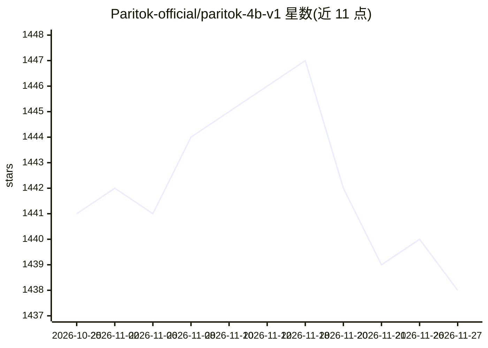

# Paritok-official/paritok-4b-v1

⭐ 1,438 · Python · Apache-2.0 · 推送 2026-11-17 · [GitHub](https://github.com/Paritok-official/paritok-4b-v1) · [官网](https://www.paritok.com/) · 组织维护 · 中文 README

**面向 coding agent 的压缩网关：代理转发并削减输入 token**

以代理形式运行在 coding agent 与 LLM API 之间的中间层：agent 将 BASE_URL 指向本网关，请求经三层处理——基于嵌入模型的工具 schema 过滤、由自研 4B 模型（Qwen3-4B 底座，45K 条 agent 轨迹训练）执行的内容压缩（文件读取/工具输出/历史，压至约 26%）、以及窗口满时的历史摘要——再转发至上游，按压缩后 token 计费。被压缩内容打 REF 标签，agent 可通过 read_original/gateway_search_tools API 按需取回原始字节。提供 /stats 可视化面板与 VS Code 扩展。

## 筛选速览

| 维度 | 判定 | 备注 |
|---|---|---|
| AI 角色 | `ai-ecosystem` | LLM/agent 周边工具 |
| 许可风险 | `permissive` | Apache-2.0 |
| 部署形态 | `library` | 以包/库形式分发 |
| 模型依赖 | — | README 未给出锁定关系 |
| 硬件要求 | `cpu-ok` | |
| 安装摩擦 | `low` | 无编译、无系统依赖或容器化 |
| 成熟度 | — | 结构信号不足 |

## 能力要点

- 三个独立节省杠杆：嵌入过滤工具 schema、4B 模型内容压缩、历史摘要
- 非破坏性设计：压缩/过滤内容可经 read_original 等本地 API 即时取回
- 工具过滤用 BAAI/bge-small-en-v1.5 嵌入模型，纯 CPU 本地运行
- README 提供逐 turn 节省测算表与按团队规模的费用测算

## 适用场景

- 给 Claude Code/Cursor 等 agent 代理接入以降低长会话 token 账单
- MCP 工具繁多时按语义过滤无关工具 schema
- 长调试/大代码库审计等读取密集型多轮会话中扩展上下文可用 turn 数

## 场景标签

`模型网关` · 领域:Agent 开发

## 证据(README 行号)

> L3:  A non-destructive compression gateway for coding agents — cut your input-token bill without changing your agent.
> L43: Paritok runs as a **middle layer between your agent and the LLM API** — your agent points at Paritok instead of Ant
> L37: - **2026-07-15** &nbsp; **Paritok gateway v1.0.0** open-sourced — the proxy/middleware that turns the 4B model into

## 星数曲线

2026-10-25 1,441 → 2026-11-27 1,438（-3）

---
*卡片 v1 · prompt 1.4 · 生成 2026-11-23 · 置信度 high · 依据 README sha `32adf5652298` · [字段定义](../../DATASET.md)*
