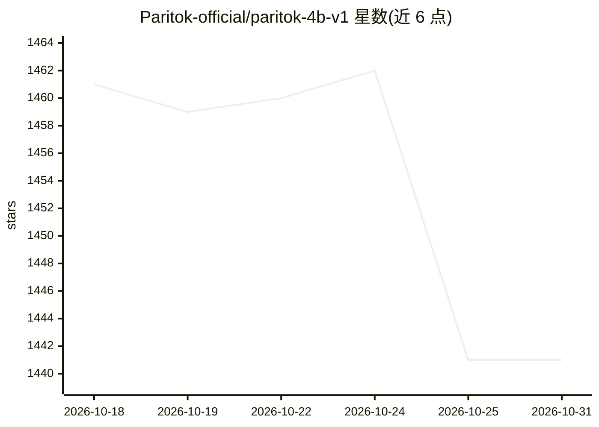

# Paritok-official/paritok-4b-v1

⭐ 1,441 · Python · Apache-2.0 · 推送 2026-10-06 · [GitHub](https://github.com/Paritok-official/paritok-4b-v1) · [官网](https://www.paritok.com/) · 组织维护

**AI 编程 agent 的无损 token 压缩网关，降低输入 token 账单**

部署在 agent 与 LLM API 之间的代理层：agent 指向 Paritok 而非 Anthropic/OpenAI，网关在每轮请求中过滤工具 schema、用自研 4B 压缩模型（Qwen3-4B 骨干，45K 轨迹训练）压缩文件读取与工具输出、摘要陈旧历史，再转发上游；压缩内容可通过 read_original 按需还原。兼容 Claude Code、Cursor、Codex、OpenHands 及任何支持 BASE_URL 的 agent。声称省 token 约 25%（首轮）到 85%+（长会话）。支持 GPU 与纯 CPU 部署。

## 筛选速览

| 维度 | 判定 | 备注 |
|---|---|---|
| AI 角色 | `ai-ecosystem` | LLM/agent 周边工具 |
| 许可风险 | `permissive` | Apache-2.0 |
| 部署形态 | `library` | 以包/库形式分发 |
| 模型依赖 | local-ok | 支持本地模型 |
| 硬件要求 | `cpu-ok` | |
| 安装摩擦 | `low` | 无编译、无系统依赖或容器化 |
| 成熟度 | — | 结构信号不足 |

## 能力要点

- 三机制叠加：嵌入工具 schema 过滤、4B 模型内容压缩（约 26% 原尺寸）、历史摘要
- 非破坏性：压缩片段可按需还原原始字节，过滤的工具可经 gateway_search_tools 取回
- 兼容 Claude Code / Cursor / Codex / OpenHands 及任何 BASE_URL agent，无需改 agent 代码
- 自带 VS Code 扩展与 /stats 实时节省看板

## 适用场景

- 降低 Claude Code / Cursor 等编程 agent 的输入 token 费用
- 在同一上下文窗口中容纳更多对话轮次
- 长会话中避免上下文溢出触发的有损压缩

## 场景标签

`模型网关` · 领域:Agent 开发

## 证据(README 行号)

> L4:  Paritok sits between your agent and the LLM as a drop-in proxy. On every request it strips the tool-schema bloat, c
> L43: Paritok runs as a **middle layer between your agent and the LLM API** — your agent points at Paritok instead of Ant
> L49:   → forwarded to Anthropic / OpenAI  (billed on the compressed tokens)

## 星数曲线

2026-10-18 1,461 → 2026-10-31 1,441（-20）

---
*卡片 v1 · prompt 1.4 · 生成 2026-10-21 · 置信度 high · 依据 README sha `888c48d81667` · [字段定义](../../DATASET.md)*
