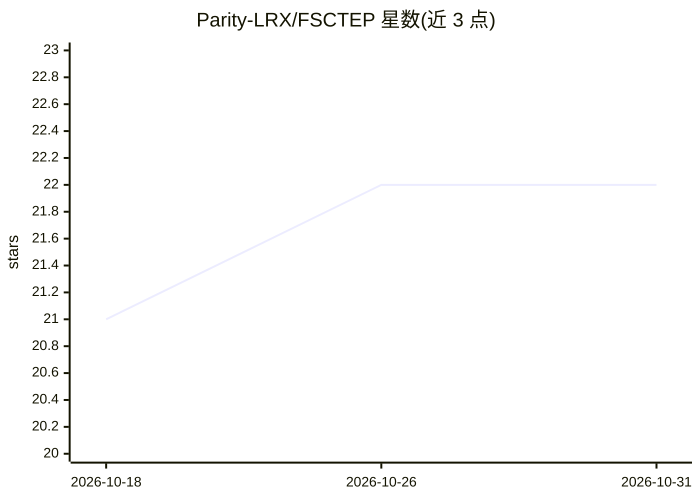

# Parity-LRX/FSCTEP

⭐ 22 · Python · NOASSERTION · 推送 2026-09-28 · [GitHub](https://github.com/Parity-LRX/FSCTEP) · [官网](https://github.com/Parity-LRX) · 组织维护 · 中文 README

**E(3)-等变机器学习力场框架，支持外场条件化与 LAMMPS 部署**

面向原子体系建模的 Python 神经势框架：提供球形、部分/稀疏笛卡尔、ICTD 等多种张量积后端，在统一训练/评估栈下支持电场/磁场等外场嵌入等变消息传递，可监督电荷、偶极、极化率、四极矩等物理张量目标，并支持多保真训练（条件化与 delta 学习）。训练后可导出 core.pt/core.pt2，经 USER-MFFTORCH（LibTorch 纯 C++）或 ML-IAP 在 LAMMPS 中运行，支持运行时外场与保真控制。附带主动学习、长程、NEB、声子等研究扩展。许可为学术非商业免费、商业用途需付费书面许可。

## 筛选速览

| 维度 | 判定 | 备注 |
|---|---|---|
| AI 角色 | `ai-native` | 本体是模型或模型工具 |
| 许可风险 | `none` | NOASSERTION |
| 部署形态 | `library` | 以包/库形式分发 |
| 模型依赖 | — | README 未给出锁定关系 |
| 硬件要求 | — | 无带数字的原话,不猜 |
| 安装摩擦 | `medium` | 含编译或系统依赖之一 |
| 成熟度 | — | 结构信号不足 |

## 能力要点

- 多种球形/笛卡尔等变张量积后端统一于一个训练评估栈
- 电场/磁场等外场嵌入与物理张量（偶极/极化率/BEC 等）监督
- 导出 TorchScript/AOTInductor 模型经 LAMMPS 三种方式部署，运行时支持外场
- train→explore→select→label(DFT)→merge 一条命令的主动学习闭环

## 适用场景

- 训练带外场响应的机器学习力场并导出到 LAMMPS 做分子动力学
- 用主动学习自动扩充欠采样区域的训练集（PySCF/VASP/SLURM）
- 多保真数据（如 PBE/HSE）混合训练同一势函数
- 基于训练模型做 NEB、声子谱与热输运计算

## 场景标签

`模型训练` · 领域:训练与推理

## 证据(README 行号)

> L8: **FusedSCEquiTensorPot** is an E(3)-equivariant neural potential for atomistic modeling with multiple tensor-product
> L18: - **Backends**: spherical, channelwise spherical (`spherical-save-cue`), partial Cartesian, sparse Cartesian, ICTD,
> L19: - **Field-aware learning**: electric field (`1o`), magnetic field (`1e`), and rank-aware tensor inputs can be embed

## 星数曲线

2026-10-18 21 → 2026-10-31 22（+1）

---
*卡片 v1 · prompt 1.4 · 生成 2026-10-27 · 置信度 high · 依据 README sha `d72638294c0e` · [字段定义](../../DATASET.md)*
