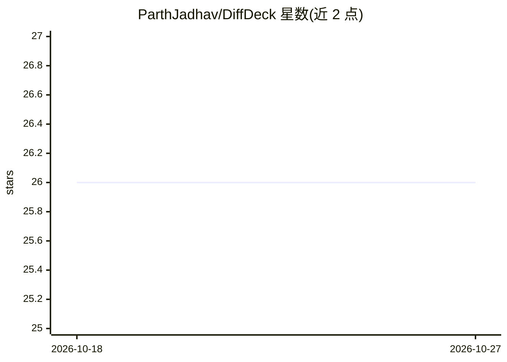

# ParthJadhav/DiffDeck

⭐ 26 · TypeScript · MIT · 推送 2026-10-03 · [GitHub](https://github.com/ParthJadhav/DiffDeck) · 个人维护

**在浏览器中查看 Git diff 并可批注导出给 AI agent 的 CLI 工具**

npm 全局安装的命令行工具：`diffdeck` 启动本地 Web UI 渲染 `git diff` 输出并自动打开浏览器，参数与 `git diff` 兼容。面向终端与 SSH 环境下缺少可视化 diff 视图的开发者；支持按行评论，评论可连同代码上下文复制为 Markdown 或版本化 JSON，交给 Claude Code、Cursor 等编码 agent 处理。默认只读绑定回环地址，写操作需 `--write` 显式开启并需确认。要求 Node.js 20+ 与 Git。

## 筛选速览

| 维度 | 判定 | 备注 |
|---|---|---|
| AI 角色 | `ai-enhanced` | 去掉 AI 部分产品仍成立 |
| 许可风险 | `permissive` | MIT |
| 部署形态 | `library` | 以包/库形式分发 |
| 模型依赖 | — | README 未给出锁定关系 |
| 硬件要求 | — | 无带数字的原话,不猜 |
| 安装摩擦 | `low` | 无编译、无系统依赖或容器化 |
| 成熟度 | — | 结构信号不足 |

## 能力要点

- `diffdeck` 启动本地 Web UI 渲染 Git diff，参数与 git diff 兼容
- 行级评论可连上下文打包为 Markdown/JSON 复制或发送到终端
- 支持大 diff（23k+ 文件虚拟化）、图片对比、无障碍线性补丁视图
- 默认只读回环绑定，`--host` 暴露时自动生成能力 token 鉴权

## 适用场景

- SSH 到服务器时仍想用可视化界面审查代码改动
- 对 diff 行写评论后一次性交给 AI 编码 agent 修复
- 在没有内置 diff 视图的编辑环境里做代码走查

## 场景标签

 · 领域:开发者工具/代码审查

## 证据(README 行号)

> L9: `diffdeck` starts a local web UI for the diff you ask Git for, then opens it in your browser. Use it when:
> L15: Optionally, you can comment on changed lines and copy all of them at once for your AI to resolve — the surrounding 
> L19: Tell your coding agent (Claude Code, Cursor, etc.):

## 星数曲线

2026-10-18 26 → 2026-10-27 26（+0）

---
*卡片 v1 · prompt 1.4 · 生成 2026-10-26 · 置信度 high · 依据 README sha `62700b94e6e7` · [字段定义](../../DATASET.md)*
