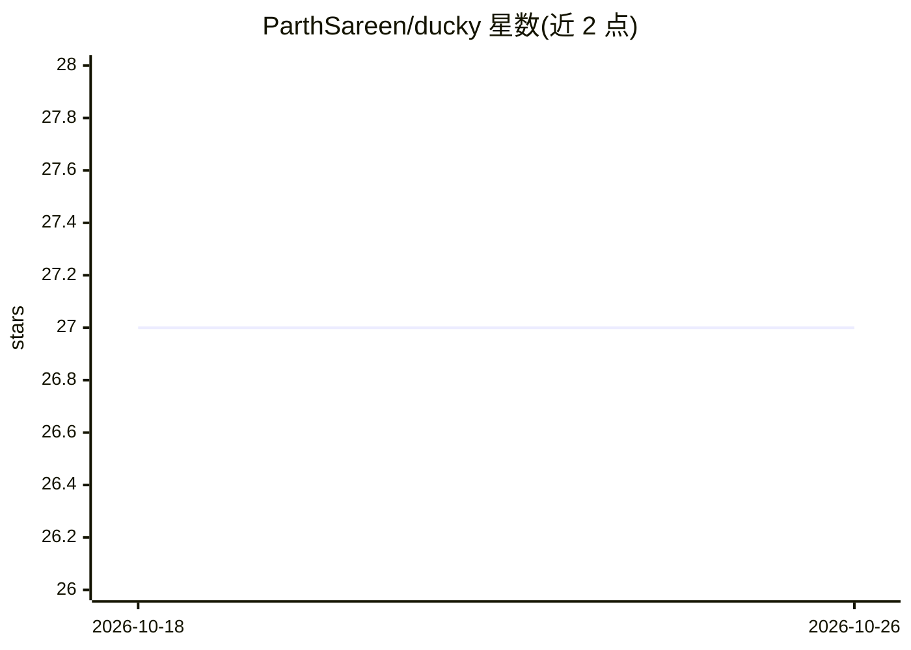

# ParthSareen/ducky

⭐ 27 · Python · MIT · 推送 2026-02-04 · [GitHub](https://github.com/ParthSareen/ducky) · 个人维护

**终端内自然语言转 bash 命令的 CLI 伴侣工具**

面向开发者的命令行工具：将自然语言提示转换为可运行的 shell 命令，支持交互式 REPL、单次调用与管道输入模式。模型侧支持本地 Ollama（默认 qwen3）与 ollama.com 云端模型切换，要求本地运行 Ollama 与 Python 3.10+。提供 Crumbs 机制保存命令快捷方式并支持参数替换，可预加载项目代码上下文、复制命令到剪贴板，以及 --yolo 免确认自动执行。通过 uv tool 全局安装，数据存储于 ~/.ducky/。

## 筛选速览

| 维度 | 判定 | 备注 |
|---|---|---|
| AI 角色 | `ai-native` | 本体是模型或模型工具 |
| 许可风险 | `permissive` | MIT |
| 部署形态 | `self-host` | docker 或自建部署 |
| 模型依赖 | local-ok | 支持本地模型 |
| 硬件要求 | — | 无带数字的原话,不猜 |
| 安装摩擦 | `low` | 无编译、无系统依赖或容器化 |
| 成熟度 | — | 结构信号不足 |

## 能力要点

- 自然语言生成 bash 命令，支持 REPL/单次/管道三种模式
- 本地 Ollama 与云端模型切换，默认 qwen3
- Crumbs 命令快捷方式与参数替换
- 可预加载项目代码上下文提升建议质量

## 适用场景

- 在终端中用自然语言快速生成并执行 shell 命令
- 保存常用复杂命令为快捷方式供复用
- 将日志或 diff 管道输入让 AI 解释

## 场景标签

`代码生成` · 领域:编码与开发

## 证据(README 行号)

> L3: Turn natural language into bash commands without leaving your terminal.
> L25: - **Natural to Shell** - Describe what you want, get the bash command

## 星数曲线

2026-10-18 27 → 2026-10-26 27（+0）

---
*卡片 v1 · prompt 1.4 · 生成 2026-10-26 · 置信度 mid · 依据 README sha `0bcd547fe317` · [字段定义](../../DATASET.md)*
