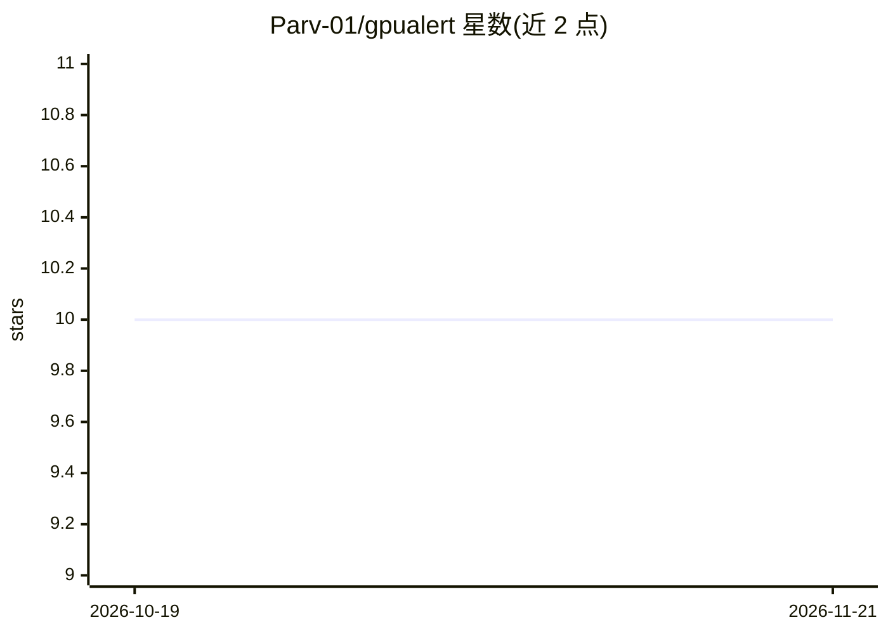

# Parv-01/gpualert

⭐ 10 · Python · MIT · 推送 2026-10-27 · [GitHub](https://github.com/Parv-01/gpualert) · [官网](https://pypi.org/project/gpualert/) · 组织维护

**给 ML 训练者的 GPU 任务失败诊断与邮件通知工具**

GPUAlert 是一个命令行监控工具：用 `gpualert run -- <命令>` 包裹任意 PyTorch/JAX/Slurm 训练任务，任务结束（成功/失败/超时/中断）后通过 SMTP 发送邮件，内容包括失败原因分类（15 类，如 CUDA OOM、NCCL 错误、NaN loss、OOMKiller）、完整 stdout/stderr 日志及输出文件附件。无需修改代码；通过 `sacct` 轮询已提交的 Slurm 作业；成功运行时自动提取 accuracy/loss 等指标写入邮件正文。要求 Python 3.10+、Linux/macOS 及可认证的 SMTP 账户。配套 gpualert-eval 提供标注语料与评估工具。

## 筛选速览

| 维度 | 判定 | 备注 |
|---|---|---|
| AI 角色 | `ai-ecosystem` | LLM/agent 周边工具 |
| 许可风险 | `permissive` | MIT |
| 部署形态 | `library` | 以包/库形式分发 |
| 模型依赖 | — | README 未给出锁定关系 |
| 硬件要求 | — | 无带数字的原话,不猜 |
| 安装摩擦 | `medium` | 含编译或系统依赖之一 |
| 成熟度 | — | 结构信号不足 |

## 能力要点

- 零代码侵入：包裹任意命令即可监控并在结束时发邮件
- 失败原因自动分类为 15 类（CUDA OOM、NCCL、OOMKiller 等）并附完整日志与输出文件
- 通过 sacct 轮询监控已提交的 Slurm 作业
- 成功运行自动检测并汇报 ML 指标（accuracy/loss/F1/mAP 等）

## 适用场景

- 长时间训练任务结束后不用 SSH 回服务器查看是否崩溃
- 训练失败时收到含失败原因和日志的邮件以便定位问题
- 监控集群上已用 sbatch 提交的 Slurm 作业状态

## 场景标签

 · 领域:MLOps/训练监控

## 证据(README 行号)

> L10: GPUAlert tells you why your GPU training job failed. Wrap any PyTorch, JAX or Slurm job with
> L25: wraps the job, writes structured logs to disk, classifies common failure modes (CUDA OOM, NCCL,
> L56: - Wraps any command and emails on completion: success, failure, timeout, or Ctrl+C.

## 星数曲线

2026-10-19 10 → 2026-11-21 10（+0）

---
*卡片 v1 · prompt 1.4 · 生成 2026-11-20 · 置信度 high · 依据 README sha `fbddb792c44d` · [字段定义](../../DATASET.md)*
