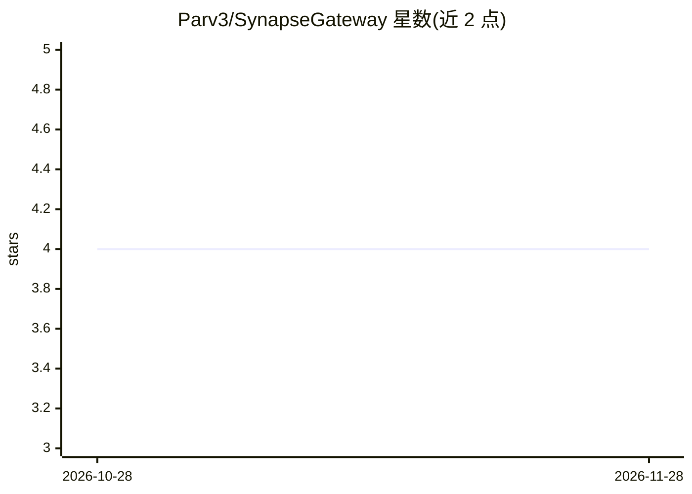

# Parv3/SynapseGateway

⭐ 4 · Python · MIT · 推送 2026-10-26 · [GitHub](https://github.com/Parv3/SynapseGateway) · 个人维护

**LLM 推理网关：语义缓存、PII 拦截与故障转移**

基于 FastAPI 的异步反向代理，置于客户端应用与上游 LLM 提供商之间，兼容 OpenAI SDK 接口。核心机制包括：两级语义向量缓存（哈希精确匹配 + ONNX 嵌入的 384 维向量余弦检索，按查询长度动态调整阈值）、多租户命名空间隔离、三态有限状态熔断器在提供商 429/503 时自动切换备用通道（Anthropic/Groq/vLLM/Ollama），以及 Luhn 校验的信用卡号、PII 与密钥脱敏和提示注入模式拦截。附基准测试脚本与 pytest 测试套件，无 API key 时可运行内置本地模拟器。

## 筛选速览

| 维度 | 判定 | 备注 |
|---|---|---|
| AI 角色 | `ai-ecosystem` | LLM/agent 周边工具 |
| 许可风险 | `permissive` | MIT |
| 部署形态 | `None` |  |
| 模型依赖 | local-ok | 支持本地模型 |
| 硬件要求 | — | 无带数字的原话,不猜 |
| 安装摩擦 | `low` | 无编译、无系统依赖或容器化 |
| 成熟度 | — | 结构信号不足 |

## 能力要点

- 两级语义向量缓存：L1 哈希精确匹配 + L2 ONNX 384 维向量检索，动态相似度阈值
- 三态熔断器（CLOSED/OPEN/HALF_OPEN）实现提供商故障自动转移
- Luhn 校验的 PII/密钥脱敏与提示注入风险评分拦截
- 多租户 X-Tenant-ID 缓存命名空间隔离

## 适用场景

- 为生产 LLM 应用缓存语义重复查询以减少上游调用
- 多租户 SaaS 中隔离各租户的缓存数据
- 上游提供商限流或宕机时保持服务可用
- 出口前拦截提示中的敏感信息与注入攻击

## 场景标签

`模型网关` · 领域:Agent 开发

## 证据(README 行号)

> L3: An asynchronous, drop-in AI inference gateway that sits between client applications and upstream LLM providers. It b
> L19: SynapseGateway runs locally or on the edge as an OpenAI-compatible reverse proxy, resolving semantically identical 

## 星数曲线

2026-10-28 4 → 2026-11-28 4（+0）

---
*卡片 v1 · prompt 1.4 · 生成 2026-11-21 · 置信度 high · 依据 README sha `90833d7d0dff` · [字段定义](../../DATASET.md)*
