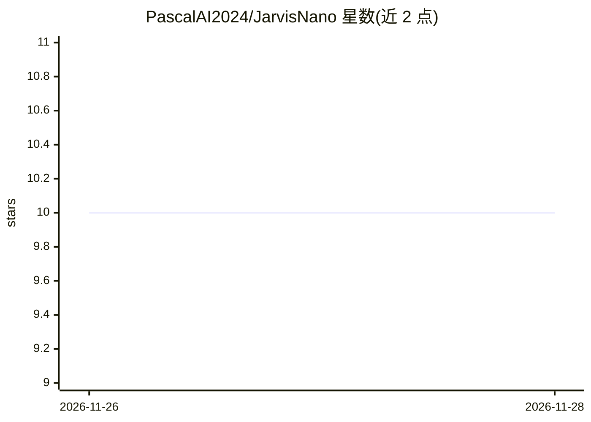

# PascalAI2024/JarvisNano

⭐ 10 · C · Apache-2.0 · 推送 2026-11-27 · [GitHub](https://github.com/PascalAI2024/JarvisNano) · 个人维护

**面向 Waveshare ESP32-S3 AMOLED 开发板的语音优先桌面 AI 伴侣固件**

JarvisNano 将 Waveshare ESP32-S3-Touch-AMOLED-1.75C 开发板固化为独立运行的桌面语音伴侣：接入 Gemini Live 实现全双工语音对话，内置 28 个语音工具（22 个离线即时执行、6 个经 JarvisMCP HTTPS 网关调用），并提供 5 屏环形 OLED 界面、10 种表盘、AXP2101 电量管理、物理隐私静音、深度睡眠与 Wi-Fi OTA 更新。面向持有该特定开发板的固件开发者/爱好者，通过 Docker + ESP-IDF 5.5.4 构建烧录。安全边界说明中注明 NVS 未加密、LAN 控制平面为明文，签名 OTA 等项仍属开放发布门槛。

## 筛选速览

| 维度 | 判定 | 备注 |
|---|---|---|
| AI 角色 | `ai-native` | 本体是模型或模型工具 |
| 许可风险 | `permissive` | Apache-2.0 |
| 部署形态 | `None` |  |
| 模型依赖 | — | README 未给出锁定关系 |
| 硬件要求 | — | 无带数字的原话,不猜 |
| 安装摩擦 | `low` | 无编译、无系统依赖或容器化 |
| 成熟度 | — | 结构信号不足 |

## 能力要点

- Gemini Live 全双工语音与 WakeNet9 "Jarvis" 唤醒词
- 28 个内置语音工具，其中 22 个离线 0 ms 执行，6 个经 MCP 网关调用
- 466×466 单合成器 OLED 引擎：5 屏环形界面与 10 种表盘
- 物理隐私静音：远程 API 无法解除内圈长按/翻面静音

## 适用场景

- 在桌面放置一台语音唤醒的 J.A.R.V.I.S. 风格伴侣设备
- 用语音设置计时器、番茄钟、便签与每日简报
- 通过语音控制设备亮度、音量、表盘与桌面模式

## 场景标签

`语音 Agent` `AI 助手` · 领域:对话与助手

## 证据(README 行号)

> L3:  A voice-first J.A.R.V.I.S. desk companion on a round 466×466 AMOLED ESP32-S3.
> L45: JarvisNano turns the **Waveshare ESP32-S3-Touch-AMOLED-1.75C** into a standalone, always-ready desk companion. No p

## 星数曲线

2026-11-26 10 → 2026-11-28 10（+0）

---
*卡片 v1 · prompt 1.4 · 生成 2026-11-26 · 置信度 high · 依据 README sha `4d7365c0eb6b` · [字段定义](../../DATASET.md)*
