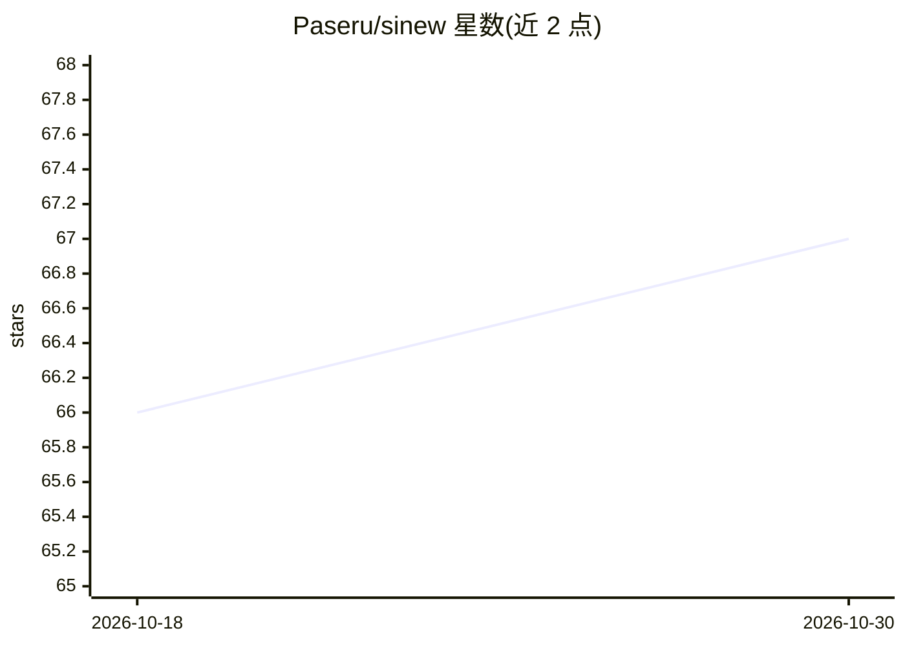

# Paseru/sinew

⭐ 67 · Rust · MIT · 推送 2026-09-24 · [GitHub](https://github.com/Paseru/sinew) · [官网](https://sinew-ide.com/) · 个人维护

**可重塑的多供应商桌面 AI 编程 harness（Tauri/Rust/React）**

Sinew 是基于 Tauri 2 + React + Rust 的桌面 AI 编程 harness，面向希望自定义 agent 行为的开发者：每个工具可开关、工具描述可编辑、供应商可插拔。提供 Act/Goal/Plan 三种模式；支持 Anthropic、OpenAI、Google、Kimi 订阅 OAuth 接入与 OpenRouter API key，可按模式/子代理/团队分别选模型。工具集含 bash（PTY 支持交互式会话）、基于 ripgrep 的 read/glob/grep（limit 必填）、clean_context（模型自行清理当前轮无用工具结果以保住前缀缓存）、MCP 工具加载、子代理与 Agent Team。自动注入 AGENTS.md 与 DESIGN.md；明确忽略 CLAUDE.md。注意 README 自述对 Claude Code/Antigravity 的 OAuth 用法属第一方保留流程，存在账号被标记的理论风险。

## 筛选速览

| 维度 | 判定 | 备注 |
|---|---|---|
| AI 角色 | `ai-native` | 本体是模型或模型工具 |
| 许可风险 | `permissive` | MIT |
| 部署形态 | `desktop` | 安装包/桌面程序 |
| 模型依赖 | locked-api |  |
| 硬件要求 | — | 无带数字的原话,不猜 |
| 安装摩擦 | `low` | 无编译、无系统依赖或容器化 |
| 成熟度 | — | 结构信号不足 |

## 能力要点

- Act/Goal/Plan 三模式，Plan 模式产出无技术黑话的功能层计划
- clean_context 工具：模型自行清理当前轮工具结果且不破坏 prompt 缓存
- 五个供应商接入（订阅 OAuth 或 OpenRouter API key），三级别按能力混配模型
- read/glob/grep 独立工具基于 ripgrep，limit 参数强制必填

## 适用场景

- 用已有 Claude/ChatGPT 等订阅驱动自定义编程 agent，无需按 API 计费
- 长任务交给 Goal 模式自主循环执行
- 通过开关工具与编辑工具描述定制极简或全功能 harness
- 用 Agent Team 与子代理并行协作完成编码任务

## 场景标签

`编码 Agent` · 领域:编码与开发

## 证据(README 行号)

> L9:  Sinew is a desktop AI coding harness you can actually reshape.
> L65: Sinew supports five model providers, each with its own connection method:
> L93: The agent has access to a full set of tools:

## 星数曲线

2026-10-18 66 → 2026-10-30 67（+1）

---
*卡片 v1 · prompt 1.4 · 生成 2026-10-24 · 置信度 mid · 依据 README sha `fdb49b009d60` · [字段定义](../../DATASET.md)*
