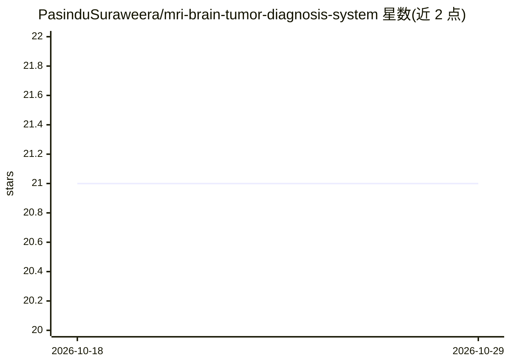

# PasinduSuraweera/mri-brain-tumor-diagnosis-system

⭐ 21 · Jupyter Notebook · 推送 2026-10-13 · [GitHub](https://github.com/PasinduSuraweera/mri-brain-tumor-diagnosis-system) · 个人维护

**用 VGG16 迁移学习对 MRI 脑肿瘤做四分类的深度学习系统**

基于 TensorFlow/Keras 的医学影像分类项目：以 ImageNet 预训练的 VGG16 为骨干，冻结大部分层并微调顶层，加入 dropout 与 dense 层，用 softmax 输出胶质瘤、脑膜瘤、垂体瘤、无肿瘤四类预测；训练中做亮度/对比度增强，评估含分类报告、混淆矩阵与 ROC/AUC，模型保存为 model.h5，提供推理函数对新 MRI 图像给出类别与置信度。后端用 Flask，部署在 Render 提供在线演示。README 声明训练数据集较小、仅供研究与教育用途，不能替代专业医疗诊断。

## 筛选速览

| 维度 | 判定 | 备注 |
|---|---|---|
| AI 角色 | `ai-native` | 本体是模型或模型工具 |
| 许可风险 | `none` | — |
| 部署形态 | `library` | 以包/库形式分发 |
| 模型依赖 | — | README 未给出锁定关系 |
| 硬件要求 | — | 无带数字的原话,不猜 |
| 安装摩擦 | `low` | 无编译、无系统依赖或容器化 |
| 成熟度 | — | 结构信号不足 |

## 能力要点

- VGG16 迁移学习 + 顶层微调的四分类（胶质瘤/脑膜瘤/垂体瘤/无肿瘤）
- 亮度/对比度实时数据增强应对小数据集
- 分类报告、混淆矩阵、ROC/AUC 评估与置信度推理
- Flask 后端部署于 Render，提供在线演示

## 适用场景

- 我想训练一个 MRI 脑肿瘤分类模型并复现评估流程
- 我想对新的 MRI 扫描图做肿瘤类型与置信度预测
- 作为深度学习在医学影像课程的示例项目学习迁移学习

## 场景标签

`微调` `教程课程` · 领域:学习与行业

## 证据(README 行号)

> L17: This project harnesses the power of **deep learning** to tackle a critical medical challenge: accurately classifyin
> L39: After training, the model is saved (`model.h5`) and can predict tumor type and confidence on new MRI images through

## 星数曲线

2026-10-18 21 → 2026-10-29 21（+0）

---
*卡片 v1 · prompt 1.4 · 生成 2026-10-28 · 置信度 mid · 依据 README sha `8a8d90559f68` · [字段定义](../../DATASET.md)*
