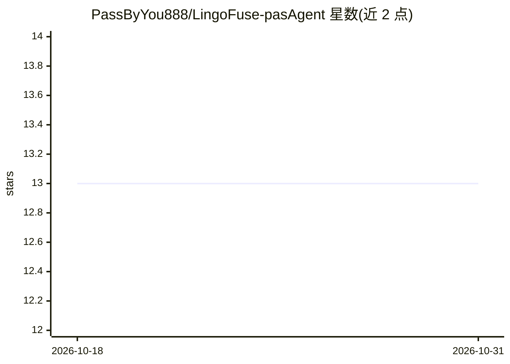

# PassByYou888/LingoFuse-pasAgent

⭐ 13 · HTML · MIT · 推送 2026-10-17 · [GitHub](https://github.com/PassByYou888/LingoFuse-pasAgent) · [官网](https://zpascal.net) · 个人维护 · 中文 README

**让 AI 直接调用存量 Pascal 代码的智能体接入体系**

面向 Pascal 开发者的 AI 智能体技术体系（v2 纯文本分支）：通过信标服务登记工具、代码生成器从函数声明生成工具提供者、MCP 网关或 LLM 工具桥让 LLM 调用任意 Pascal 函数，客户端无需懂 MCP。由 11 个可执行文件组成，含本地 GGUF 离线推理、129+ 后端转发、HTTP 桥接与调试组件。提供预编译包（内置 DLL，需 VC++ 2022 运行库），依赖 LingoFuse 动态库；代码生成器源码不在本仓库。多模态能力由 v3 平行分支承担。

## 筛选速览

| 维度 | 判定 | 备注 |
|---|---|---|
| AI 角色 | `ai-ecosystem` | LLM/agent 周边工具 |
| 许可风险 | `permissive` | MIT |
| 部署形态 | `desktop` | 安装包/桌面程序 |
| 模型依赖 | local-ok | 支持本地模型 |
| 硬件要求 | — | 无带数字的原话,不猜 |
| 安装摩擦 | `low` | 无编译、无系统依赖或容器化 |
| 成熟度 | — | 结构信号不足 |

## 能力要点

- 从 Pascal/C 函数声明自动生成工具提供者，5 层可查看/编辑/回退的确定性代码生成链
- 服务端代管工具执行（LTB），客户端只需发 generate，无需 MCP 支持
- 本地 GGUF 离线推理（llm_service）与 129+ 后端转发（llm_proxy 系列）
- 长时运行加固：单 worker 串行推理、双条件会话回收、句柄自动回收

## 适用场景

- 让存量 Pascal 生产系统的函数被 AI 当作工具直接调用
- 不写 JSON Schema、不搭 HTTP 服务，把 Pascal 函数接入 MCP 客户端
- 断网环境下用本地 GGUF 模型跑智能体与工具调用
- 让浏览器 / Node / PHP 通过 HTTP 桥访问 LingoFuse RPC

## 场景标签

`Agent 框架` `代码生成` `模型网关` `推理引擎` · 领域:Agent 开发

## 证据(README 行号)

> L46: > **让你用 Pascal 写的函数，被 AI 像内置功能一样直接调用。**
> L103: **用 `llm_proxy_tool.exe`（LTB）** —— 在对话基础上，**服务端自动帮 AI 调用你的 Pascal 工具**。你的客户端**不需要懂 MCP**，只发一条 `generate` 就行。
> L125: **用 `mcp_api_tool.exe`** —— 把 Pascal 工具翻译成 MCP 协议，给 LM Studio / Claude Desktop / Continue.dev 这类**自带 MCP 支持**的客户端使

## 星数曲线

2026-10-18 13 → 2026-10-31 13（+0）

---
*卡片 v1 · prompt 1.4 · 生成 2026-10-31 · 置信度 high · 依据 README sha `87d8f49c54dd` · [字段定义](../../DATASET.md)*
