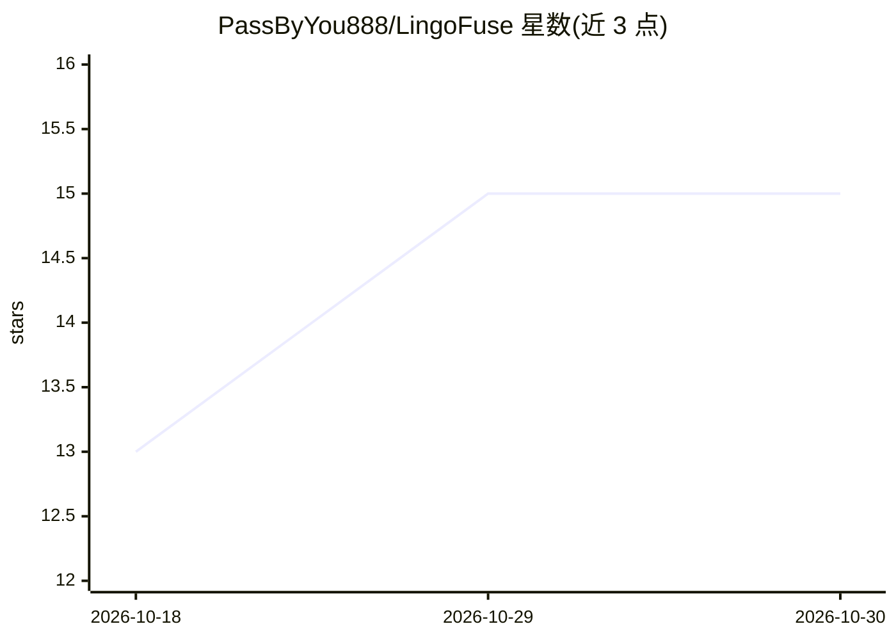

# PassByYou888/LingoFuse

⭐ 15 · C++ · MIT · 推送 2026-10-29 · [GitHub](https://github.com/PassByYou888/LingoFuse) · [官网](https://zpascal.net) · 个人维护 · 中文 README

**零 IDL 跨语言 RPC 框架：任意语言函数跨进程跨机直接互调**

跨语言、跨进程、跨机器的 RPC 框架，核心承诺是不写 IDL、不生成桩代码、不搭 HTTP 服务即可让不同语言直接调用函数。内置服务发现、负载均衡、FIFO 顺序保证与断线重连，同机 IPC 延迟声称 < 1 ms。提供 18 种语言第一方手写绑定（各带独立测试体系），另以 LingoFuse-Tools 提供 20+ 语言的代码生成器，可从一份声明同时产出二进制 ABI、HTTP JSON 与 MCP 三种协议产物。README 明确声明这是单人维护的基础设施，使用者需自行处理编译、线程模型与架构设计。

## 筛选速览

| 维度 | 判定 | 备注 |
|---|---|---|
| AI 角色 | `ai-ecosystem` | LLM/agent 周边工具 |
| 许可风险 | `permissive` | MIT |
| 部署形态 | `desktop` | 安装包/桌面程序 |
| 模型依赖 | — | README 未给出锁定关系 |
| 硬件要求 | — | 无带数字的原话,不猜 |
| 安装摩擦 | `high` | 编译与系统依赖俱全 |
| 成熟度 | — | 结构信号不足 |

## 能力要点

- 18 种语言第一方绑定，各带独立 README 与测试体系
- 零 IDL 强类型调用：C++ 声明可直接被 C#/Rust/Swift/Java 调用
- LingoFuse-Tools 从一份声明生成 ABI/JSON/MCP 三套产物，覆盖 20+ 语言
- 内置服务发现、负载均衡、FIFO 顺序保证与断线重连

## 适用场景

- 多语言混合的系统间做跨进程/跨机器函数调用
- 把一组 API 铺到十几种语言并保持线格式一致
- 将函数声明暴露为 AI Agent 可调用的 MCP 工具

## 场景标签

`代码生成` · 领域:编码与开发

## 证据(README 行号)

> L33: LingoFuse 是一个**跨语言、跨进程、跨机器**的 RPC 框架。
> L35: 核心承诺一句话：**任何语言写的函数，任何其他语言都能直接调。**
> L208: |**`code_decl_to_mcp`**|MCP|把函数暴露为 AI Agent 可调用的工具|

## 星数曲线

2026-10-18 13 → 2026-10-30 15（+2）

---
*卡片 v1 · prompt 1.4 · 生成 2026-10-30 · 置信度 high · 依据 README sha `47c8f1c4b863` · [字段定义](../../DATASET.md)*
