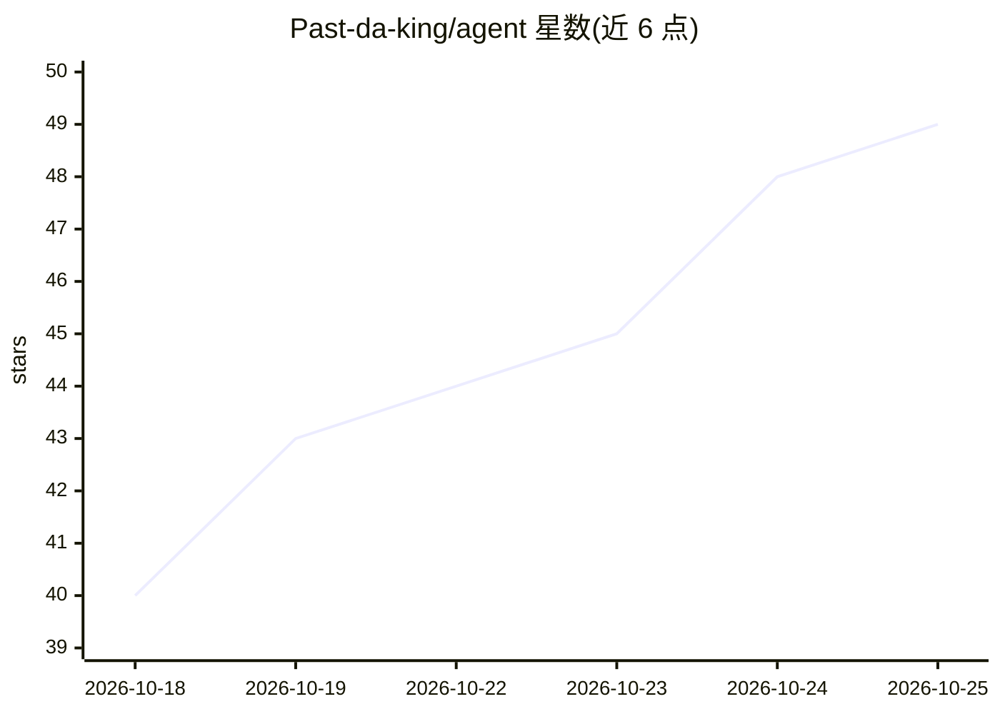

# Past-da-king/agent

⭐ 52 · Kotlin · MIT · 推送 2026-10-25 · [GitHub](https://github.com/Past-da-king/agent) · [官网](https://past-da-king.github.io/agent/) · 个人维护

**Android 常驻自主 agent 应用：自带浏览器与 wiki 记忆**

运行在 Android 手机上的常驻自主 agent 应用：自带内置浏览器执行网页任务，将习得信息写入本地 wiki 记忆，支持定时/事件触发的例程、通过 Composio 接入 Gmail 等数百应用、经 SSH 把重活交给用户自己的机器，并对花钱/发信操作设置批准门。模型由用户自带：粘贴 DeepSeek/OpenRouter/Gemini/Claude/OpenAI 等 API key，或用任意 OpenAI 兼容端点（含 Ollama/vLLM/LM Studio 自托管），或以 ChatGPT/Claude 订阅登录。以 APK 侧载安装（约 360 MB，Android 10+ arm64），MIT 开源，主要在一台三星手机上测试，自述为早期软件。

## 筛选速览

| 维度 | 判定 | 备注 |
|---|---|---|
| AI 角色 | `ai-native` | 本体是模型或模型工具 |
| 许可风险 | `permissive` | MIT |
| 部署形态 | `None` |  |
| 模型依赖 | local-ok | 支持本地模型 |
| 硬件要求 | — | 无带数字的原话,不猜 |
| 安装摩擦 | `medium` | 含编译或系统依赖之一 |
| 成熟度 | `idea` | |

## 能力要点

- 自带 WebView 浏览器的前台服务，息屏后持续工作
- 本地 wiki 记忆（Room 数据库），用户可读改删
- 经 Composio 接入数百应用，按任务申请权限
- SSH 接入自有机器执行命令，变更前展示完整命令
- 支持 API key、OpenAI 兼容端点或 ChatGPT/Claude 订阅三种供能方式

## 适用场景

- 让手机上的 agent 替我查价、比价并盯价格变动
- 定时生成晨间简报、整理记忆与笔记
- 把长任务交给自己的 PC 或 VPS 运行

## 场景标签

`AI 助手` `浏览器自动化` `Agent 记忆` · 领域:Agent 开发

## 证据(README 行号)

> L5: An autonomous, always-on agent on your phone.
> L7: You bring the model. Paste an API key, or sign in with the ChatGPT or Claude plan you already pay for.
> L34: **It goes and looks.** The agent drives its own built-in browser. It cannot control your existing Chrome tabs, so y

## 星数曲线

2026-10-18 40 → 2026-10-25 49（+9）

---
*卡片 v1 · prompt 1.4 · 生成 2026-10-24 · 置信度 high · 依据 README sha `120a09ac99c5` · [字段定义](../../DATASET.md)*
