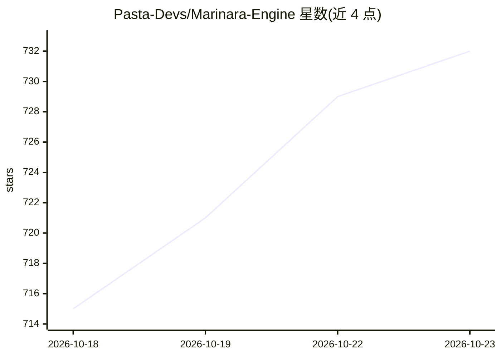

# Pasta-Devs/Marinara-Engine

⭐ 732 · TypeScript · AGPL-3.0 · 推送 2026-10-22 · [GitHub](https://github.com/Pasta-Devs/Marinara-Engine) · [官网](https://spicymarinara.github.io/) · 组织维护

**本地运行的 AI 聊天、角色扮演与游戏引擎**

本地优先的 AI 前端引擎，面向终端用户：提供 Conversation（Discord 式私信）、Roleplay（角色立绘与场景）、Game（AI 游戏主持人）三种模式；支持从 OpenAI、Anthropic、DeepSeek 等云服务到 Ollama、LM Studio、KoboldCpp 等本地端点接入，并内置一个本地小模型承担追踪、文枢检索等辅助任务。可选下载的 Agent 系统负责世界状态、配图、音乐、长期记忆等。提供 Docker、Windows 安装包、Android APK（Termux 引导）与 PWA 等多平台安装途径。README 声明为 Beta 软件，预期存在粗糙边缘与破坏性变更；本地安全默认环回免认证，局域网需 Basic Auth。

## 筛选速览

| 维度 | 判定 | 备注 |
|---|---|---|
| AI 角色 | `ai-native` | 本体是模型或模型工具 |
| 许可风险 | `viral` | AGPL-3.0 |
| 部署形态 | `desktop` | 安装包/桌面程序 |
| 模型依赖 | local-ok | 支持本地模型 |
| 硬件要求 | — | 无带数字的原话,不猜 |
| 安装摩擦 | `low` | 无编译、无系统依赖或容器化 |
| 成熟度 | `idea` | |

## 能力要点

- 三种聊天模式（对话/角色扮演/游戏），角色可跨模式共享记忆
- 支持十余家云服务商与任意 OpenAI 兼容端点，含 Ollama/LM Studio/KoboldCpp 本地服务
- 可选下载的 Agent 目录：写作、世界状态追踪、配图、音乐、长期记忆等
- 多平台安装：Docker/Podman、Windows 安装包、Android APK（Termux 引导）、iOS PWA

## 适用场景

- 在本地与 AI 角色进行沉浸式对话或角色扮演
- 以 AI 游戏主持人身份进行带队伍、任务与战斗的游戏
- 接入自有 API 或本地模型服务进行隐私优先的聊天
- 通过下载 Agent 扩展配图、音乐、长期记忆等能力

## 场景标签

`聊天机器人` · 领域:对话与助手

## 证据(README 行号)

> L5:  A local, AI-powered chat, roleplay, and game engine built around one idea: you install it, you run it, and it just 
> L100: Three chat modes — **Conversation** (Discord-style DMs), **Roleplay** (immersive RPG with sprites and backgrounds)
> L142: - **Chat models:** OpenAI, Anthropic, Google Gemini, Google Vertex AI, OpenRouter, NanoGPT, Mistral, Cohere, xAI /

## 星数曲线

2026-10-18 715 → 2026-10-23 732（+17）

---
*卡片 v1 · prompt 1.4 · 生成 2026-10-21 · 置信度 high · 依据 README sha `2dbad63dc1b6` · [字段定义](../../DATASET.md)*
