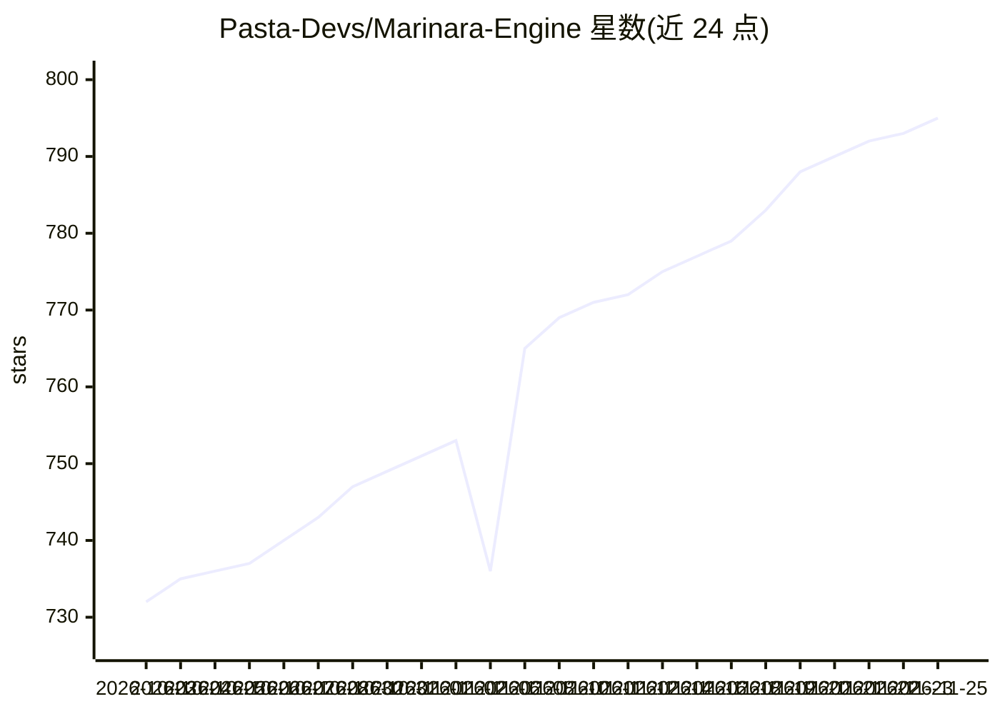

# Pasta-Devs/Marinara-Engine

⭐ 795 · TypeScript · AGPL-3.0 · 推送 2026-11-23 · [GitHub](https://github.com/Pasta-Devs/Marinara-Engine) · [官网](https://spicymarinara.github.io/) · 个人维护

**本地运行的角色扮演聊天与游戏引擎，直接产出 AI 内容**

一个本地优先的聊天、角色扮演与游戏引擎，支持三种模式：Discord 风格对话、带立绘与背景的沉浸式角色扮演、以及带 AI Game Master 的游戏模式。接入多家模型服务商与本地服务器，并内置一个无需 API key 的本地小模型处理辅助任务。通过可选的 Agent 系统扩展功能（追踪世界状态、绘图、音乐等），支持自定义 Agent、提示词工程、主题定制，可经 PWA 在移动端使用。当前为 Beta，可能存在破坏性变更。

## 筛选速览

| 维度 | 判定 | 备注 |
|---|---|---|
| AI 角色 | `ai-native` | 本体是模型或模型工具 |
| 许可风险 | `viral` | AGPL-3.0 |
| 部署形态 | `desktop` | 安装包/桌面程序 |
| 模型依赖 | local-ok | 支持本地模型 |
| 硬件要求 | — | 无带数字的原话,不猜 |
| 安装摩擦 | `low` | 无编译、无系统依赖或容器化 |
| 成熟度 | `idea` | |

## 能力要点

- 三种聊天模式，角色记忆可跨模式共享
- 可选 Agent 系统：追踪、绘图、音乐、记忆等，按需安装
- 支持 OpenAI 兼容端点与 Ollama/LM Studio/KoboldCpp 等本地服务器
- 内置本地小模型，无需 API key 即可运行辅助任务

## 适用场景

- 与 AI 角色进行角色扮演或对话
- 用 AI Game Master 跑团推演任务与战斗
- 从 SillyTavern 或多个角色卡站导入角色
- 在手机上通过 PWA 继续对话与游戏

## 场景标签

`聊天机器人` · 领域:对话与助手

## 证据(README 行号)

> L5:  A local, AI-powered chat, roleplay, and game engine built around one idea: you install it, you run it, and it just 
> L142: - **Chat models:** OpenAI, Anthropic, Google Gemini, Google Vertex AI, OpenRouter, NanoGPT, Mistral, Cohere, xAI /

## 星数曲线

2026-10-23 732 → 2026-11-25 795（+63）

---
*卡片 v1 · prompt 1.4 · 生成 2026-11-24 · 置信度 high · 依据 README sha `0d719fb91344` · [字段定义](../../DATASET.md)*
