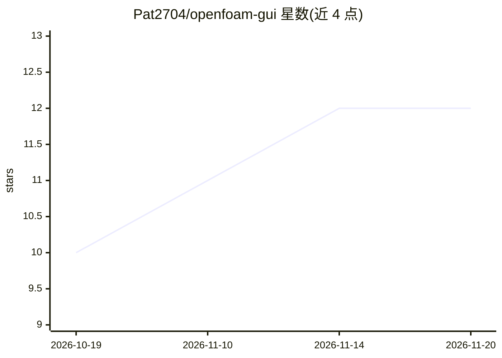

# Pat2704/openfoam-gui

⭐ 12 · TypeScript · MIT · 推送 2026-11-17 · [GitHub](https://github.com/Pat2704/openfoam-gui) · [官网](https://github.com/Pat2704/openfoam-gui/releases/latest) · 个人维护

**WSL2 下运行 OpenFOAM CFD 的 Windows 桌面 GUI，内置 AI 助手**

面向 Windows 用户的 OpenFOAM CFD 桌面应用，通过 WSL2 (Ubuntu) 驱动求解器：提供案例仪表盘、模板建案向导、带折叠/正则查找的字典文件编辑器、命令运行与实时日志监控、残差绘图、网格 3D 预览、后处理图表（读取 postProcessing/ 数据并统计收敛状态）、内嵌 ParaView 工作台与视频导出。内置三个 AI 组件：FOAMy 聊天副驾驶（读取案例文件并提议一键应用的修改，需 LLM API key）、Claude 与 Codex 智能体（直接读写运行案例，分别依赖 Claude 桌面应用与 Codex CLI，走用户自有订阅）。免安装、单 exe 便携运行。

## 筛选速览

| 维度 | 判定 | 备注 |
|---|---|---|
| AI 角色 | `ai-enhanced` | 去掉 AI 部分产品仍成立 |
| 许可风险 | `permissive` | MIT |
| 部署形态 | `desktop` | 安装包/桌面程序 |
| 模型依赖 | — | README 未给出锁定关系 |
| 硬件要求 | — | 无带数字的原话,不猜 |
| 安装摩擦 | `low` | 无编译、无系统依赖或容器化 |
| 成熟度 | — | 结构信号不足 |

## 能力要点

- 单文件便携 exe，无安装器、不写注册表，无需 Node.js
- 模板向导读取已装 OpenFOAM 版本并按其布局写案例、预先校验
- 内置 ParaView 风格工作台（pvpython 后台会话）与 MP4/OGV 视频导出
- FOAMy 副驾驶读取案例文件并提出一键应用的编辑建议

## 适用场景

- 在 Windows 上图形化管理与运行 WSL2 内的 OpenFOAM 案例
- 通过聊天让 AI 智能体代为修改并运行 CFD 案例
- 在线监控求解残差并导出力系数、压降等后处理图表

## 场景标签

 · 领域:工程仿真/CFD 工具

## 证据(README 行号)

> L7: A desktop GUI for running **OPENFOAM®** CFD simulations inside **WSL2 (Ubuntu)**
> L8: on Windows, with three AI helpers built in: **FOAMy**, a copilot that proposes
> L9: edits you apply, and **Claude** and **Codex**, agents that do the work themselves.
> L205: - **FOAMy** — a chat copilot that reads your case files and proposes edits you

## 星数曲线

2026-10-19 10 → 2026-11-20 12（+2）

---
*卡片 v1 · prompt 1.4 · 生成 2026-11-18 · 置信度 high · 依据 README sha `8b7e16b80a9e` · [字段定义](../../DATASET.md)*
