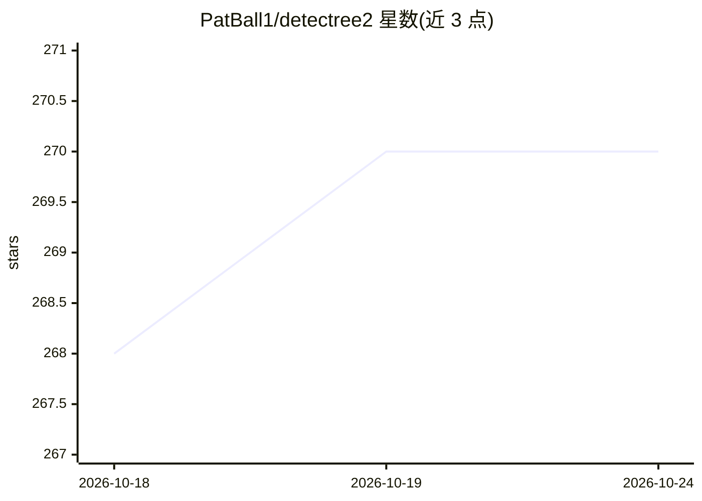

# PatBall1/detectree2

⭐ 270 · Python · MIT · 推送 2026-03-16 · [GitHub](https://github.com/PatBall1/detectree2) · [官网](https://patball1.github.io/detectree2/) · 组织维护 · 中文 README

**基于 Mask R-CNN 的树冠自动检测与分割 Python 库**

剑桥大学森林生态与保护组开发的遥感分析包：对航空 RGB 与多光谱影像做树冠检测与分割，基于 Detectron2 的 Mask R-CNN 实现，model_garden 提供预训练模型可选。标准工作流为切片正射影像与标注、训练模型、评估、全区域预测。依赖 GDAL、PyTorch 与 Detectron2，训练需 GPU（CUDA）建议，pip 安装。提供 Hugging Face 在线演示（无需安装/GPU），并附带论文与独立验证结果。面向生态研究与林业遥感场景的开发者/科研用户。

## 筛选速览

| 维度 | 判定 | 备注 |
|---|---|---|
| AI 角色 | `ai-native` | 本体是模型或模型工具 |
| 许可风险 | `permissive` | MIT |
| 部署形态 | `library` | 以包/库形式分发 |
| 模型依赖 | — | README 未给出锁定关系 |
| 硬件要求 | — | 无带数字的原话,不猜 |
| 安装摩擦 | `medium` | 含编译或系统依赖之一 |
| 成熟度 | — | 结构信号不足 |

## 能力要点

- 对航空 RGB/多光谱影像做树冠检测与分割
- model_garden 提供可选预训练模型
- Hugging Face 在线演示（免安装、无需 GPU）
- 提供数据准备/训练/预测教程与示例数据

## 适用场景

- 热带密林影像中自动勾绘单株树冠
- 城市行道树计数与多时相树冠分割
- 生态研究中基于无人机航拍做森林监测

## 场景标签

`目标检测` `科研工具` `教程课程` · 领域:学习与行业

## 证据(README 行号)

> L6: Python package for automatic tree crown delineation in aerial RGB and multispectral imagery based on Mask R-CNN. Pre
> L91: Detectree2, based on the Detectron2 Mask R-CNN architecture, locates

## 星数曲线

2026-10-18 268 → 2026-10-24 270（+2）

---
*卡片 v1 · prompt 1.4 · 生成 2026-10-22 · 置信度 high · 依据 README sha `54d0926cf3d5` · [字段定义](../../DATASET.md)*
