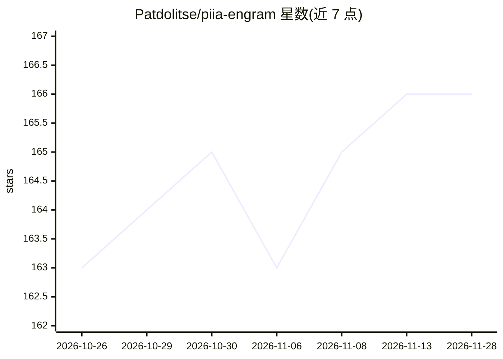

# Patdolitse/piia-engram

⭐ 166 · Python · AGPL-3.0 · 推送 2026-11-27 · [GitHub](https://github.com/Patdolitse/piia-engram) · [官网](https://pypi.org/project/piia-engram/) · 个人维护 · 中文 README

**为 MCP 编码工具提供跨端可携带的本地 AI 身份记忆层**

本地优先的个人 AI 工作身份层：用户一次声明偏好、质量标准、经验教训与项目上下文，存储于 ~/.engram/ 下的 JSON/Markdown 文件；通过 MCP over stdio 让 Claude Code、Codex、Cursor 等多个编码工具读取同一份身份与长期知识，实现跨工具连续性。安装向导自动检测本机 AI 工具并写入 MCP 配置（写入前备份、需确认）。提供 Memory Lens 只读预览哪些知识会被暴露或隐去，高风险写入（凭据、shell 命令等）需用户审批。需要 Python 3.10+，以 pip 安装。

## 筛选速览

| 维度 | 判定 | 备注 |
|---|---|---|
| AI 角色 | `ai-ecosystem` | LLM/agent 周边工具 |
| 许可风险 | `dual` | AGPL-3.0 |
| 部署形态 | `library` | 以包/库形式分发 |
| 模型依赖 | — | README 未给出锁定关系 |
| 硬件要求 | — | 无带数字的原话,不猜 |
| 安装摩擦 | `low` | 无编译、无系统依赖或容器化 |
| 成熟度 | — | 结构信号不足 |

## 能力要点

- 本地 JSON/Markdown 存储，无云端账户，数据可自行查看编辑迁移
- 19 个核心 MCP 工具 + 40 个进阶工具（ENGRAM_TOOLS=all 开启）
- Memory Lens（engram preview --html）只读预览 AI 调用方可见内容与被隐去项
- 会话摘要自动提取经验教训，多步工作流自动生成 playbook 草稿

## 适用场景

- 在 Claude Code、Codex、Cursor 之间切换时保持相同的个人上下文
- 向 AI 工具统一传达代码规范、质量标准与沟通偏好
- 将经验教训与关键决策沉淀为可跨项目复用的知识

## 场景标签

`Agent 记忆` · 领域:Agent 开发

## 证据(README 行号)

> L29: > **TL;DR:** piia-engram is a local-first personal AI identity layer. It helps multiple coding agents start from th
> L61: pip install piia-engram && engram setup
> L92: |Claude Code|MCP over stdio|L4 partial continuity proof (Claude Code -> Codex)|

## 星数曲线

2026-10-26 163 → 2026-11-28 166（+3）

---
*卡片 v1 · prompt 1.4 · 生成 2026-11-28 · 置信度 high · 依据 README sha `07d75d60f529` · [字段定义](../../DATASET.md)*
