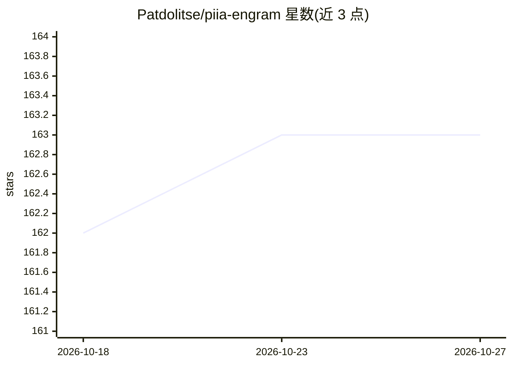

# Patdolitse/piia-engram

⭐ 163 · Python · AGPL-3.0 · 推送 2026-10-23 · [GitHub](https://github.com/Patdolitse/piia-engram) · [官网](https://pypi.org/project/piia-engram/) · 个人维护 · 中文 README

**本地优先的个人 AI 工作身份层，跨 MCP 编码工具可移植**

piia-engram 是用户自有的本地 AI 身份与长期知识层：身份卡、质量标准、偏好、经验教训、关键决策与项目上下文以 JSON/Markdown 存于 ~/.engram/，通过 MCP over stdio 供 Claude Code、Codex、Cursor、Windsurf 等 16 种编码工具读取，实现跨工具上下文延续。提供 19 个核心 MCP 工具与 40 个进阶工具，含知识继承、会话洞察提取、playbook 自动抽取、本地工具注册表。高敏感写入需用户审批（可设 strict 模式全量审批），Memory Lens 可预览 AI 实际收到的内容。Python 3.10+，pip 安装，AGPL v3。

## 筛选速览

| 维度 | 判定 | 备注 |
|---|---|---|
| AI 角色 | `ai-ecosystem` | LLM/agent 周边工具 |
| 许可风险 | `dual` | AGPL-3.0 |
| 部署形态 | `library` | 以包/库形式分发 |
| 模型依赖 | — | README 未给出锁定关系 |
| 硬件要求 | — | 无带数字的原话,不猜 |
| 安装摩擦 | `low` | 无编译、无系统依赖或容器化 |
| 成熟度 | — | 结构信号不足 |

## 能力要点

- 本地 JSON/Markdown 存储于 ~/.engram/，用户可打开、编辑、备份
- 通过 MCP over stdio 接入 16 种 AI 编码工具，附分级证据状态表
- 高风险写入（凭据/命令/MCP 配置）需用户审批，其余可审计可回滚
- Memory Lens 预览 AI 调用方实际接收的内容与扣留项

## 适用场景

- 在 Claude Code、Codex、Cursor 等工具间携带同一份个人偏好与经验
- 让新对话/新项目复用过往项目的经验教训与决策记录
- 审计和控制 AI 对个人身份数据的读取与写入

## 场景标签

`Agent 记忆` · 领域:Agent 开发

## 证据(README 行号)

> L29: > **TL;DR:** piia-engram is a local-first personal AI identity layer. It helps multiple coding agents start from th
> L92: |Claude Code|MCP over stdio|L4 partial continuity proof (Claude Code -> Codex)|
> L137: **piia-engram gives you a personal identity layer that lives on your machine, independent of any AI tool.** You te

## 星数曲线

2026-10-18 162 → 2026-10-27 163（+1）

---
*卡片 v1 · prompt 1.4 · 生成 2026-10-22 · 置信度 high · 依据 README sha `ffc54307f624` · [字段定义](../../DATASET.md)*
