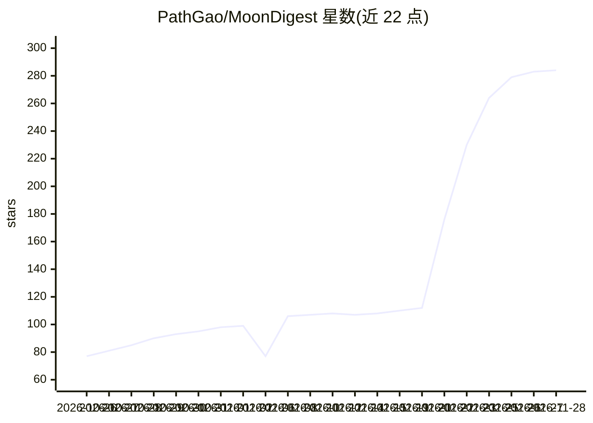

# PathGao/MoonDigest

⭐ 284 · JavaScript · GPL-3.0 · 推送 2026-11-24 · [GitHub](https://github.com/PathGao/MoonDigest) · [官网](https://chromewebstore.google.com/detail/bnjihpbocpimaipifanfkjjpfdbigggd) · 个人维护 · 中文 README

**用 AI 帮你读完 B站/YouTube 收藏视频并分拣整理的浏览器扩展**

Chrome MV3 扩展，核心功能三块：读——查看并下载 B站/YouTube 字幕，AI 侧边栏总结视频或网页并追问，无字幕时用简介和热门评论总结；理——分拣台让 AI 逐个评估收藏夹视频并给出保留/清理建议，支持标签与观看进度；记——保存备注与对话，导出 Markdown 或写入 Obsidian。数据全部存在浏览器本地，无作者服务器。另提供 skill 与 MCP 两种方式供 AI agent 借浏览器登录态读取视频内容并操作 B站账号。

## 筛选速览

| 维度 | 判定 | 备注 |
|---|---|---|
| AI 角色 | `ai-native` | 本体是模型或模型工具 |
| 许可风险 | `viral` | GPL-3.0 |
| 部署形态 | `library` | 以包/库形式分发 |
| 模型依赖 | — | README 未给出锁定关系 |
| 硬件要求 | — | 无带数字的原话,不猜 |
| 安装摩擦 | `low` | 无编译、无系统依赖或容器化 |
| 成熟度 | — | 结构信号不足 |

## 能力要点

- AI 分拣台逐个评估收藏夹视频的留/清建议
- 字幕查看与 SRT/TXT 下载，无字幕时用简介+评论总结
- MCP/skill 让 agent 读取字幕、截图并操作收藏夹
- 数据全存浏览器本地，无作者服务器

## 适用场景

- 批量清理 B站收藏夹里没看的视频
- 看长视频前先用 AI 总结判断值不值得看
- 把视频笔记导出到 Obsidian 做知识管理
- 让 AI agent 帮你搜集并阅读视频资料

## 场景标签

`知识库管理` · 领域:知识与检索

## 证据(README 行号)

> L5: 收藏了却没看的视频、想读的网页，用 AI 帮你读完、整理好，挑出真正要看的。
> L21: 2. 设置 → 「AI 平台」 → 「+ 添加平台」，选预设，填 API Key，点「测试连接」。浏览器问能否访问这个地址时点允许。设置改了就存，不用点保存。支持 DeepSeek、智谱 GLM、Kimi、MiniMax、Open
> L45: ## 给 AI agent 用

## 星数曲线

2026-10-26 77 → 2026-11-28 284（+207）

---
*卡片 v1 · prompt 1.4 · 生成 2026-11-25 · 置信度 mid · 依据 README sha `d17ca97cd11b` · [字段定义](../../DATASET.md)*
