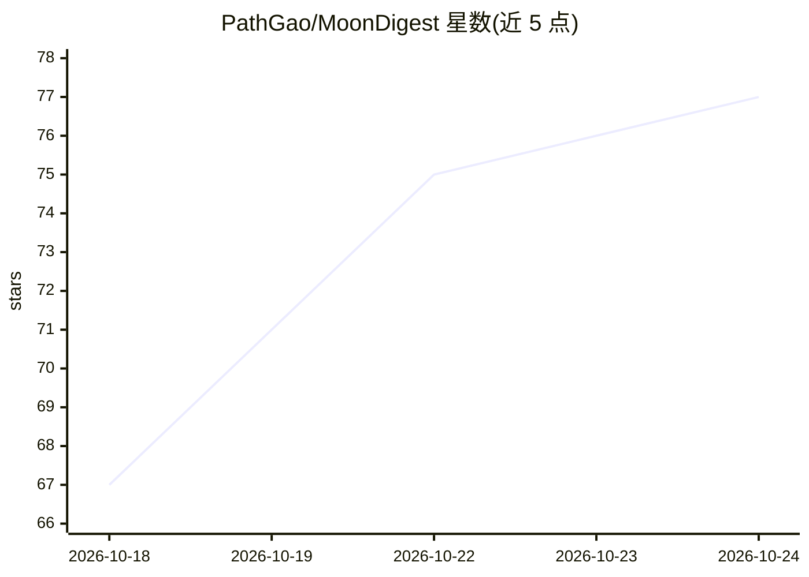

# PathGao/MoonDigest

⭐ 77 · JavaScript · GPL-3.0 · 推送 2026-10-24 · [GitHub](https://github.com/PathGao/MoonDigest) · [官网](https://chromewebstore.google.com/detail/bnjihpbocpimaipifanfkjjpfdbigggd) · 个人维护 · 中文 README

**用 AI 读字幕、总结问答并分拣 B站/YouTube 收藏夹的 Chrome 扩展**

Chrome MV3 扩展，面向视频收藏夹囤积用户，做三件事：读——抓取 B站/YouTube 视频的人工、AI 和自动字幕，在侧边栏做 AI 总结与追问，普通网页可提取正文让 AI 读取；理——分拣台对 B站收藏夹先标题粗看再字幕细看，给出值得留/可清理/拿不准判断，支持保留、取消收藏、标签与待播；记——备注与 AI 对话导出 Markdown，可选经 Obsidian Local REST API 写入库。支持任意 OpenAI 兼容接口（DeepSeek/智谱/Kimi/MiniMax/OpenRouter 预设），API 调用花用户自己的 Key，所有数据存浏览器本地，无作者服务器。不支持 Firefox，B站字幕需登录。

## 筛选速览

| 维度 | 判定 | 备注 |
|---|---|---|
| AI 角色 | `ai-native` | 本体是模型或模型工具 |
| 许可风险 | `viral` | GPL-3.0 |
| 部署形态 | `None` |  |
| 模型依赖 | locked-api |  |
| 硬件要求 | — | 无带数字的原话,不猜 |
| 安装摩擦 | `low` | 无编译、无系统依赖或容器化 |
| 成熟度 | — | 结构信号不足 |

## 能力要点

- 字幕抓取（人工/AI/自动生成）与视频页 AI 侧边栏总结、追问
- B站收藏夹分拣台：标题粗看（每批20标题）+ 字幕细看两级 AI 判断
- Markdown 导出与可选 Obsidian 写入（经 Local REST API）
- 任意 OpenAI 兼容接口，多平台预设可切换，数据全部本地存储

## 适用场景

- 让 AI 总结长视频字幕，决定是否值得看
- 批量分拣越积越多的 B站收藏夹
- 把视频笔记和 AI 问答归档到 Obsidian 知识库

## 场景标签

`知识库管理` `AI 写作` · 领域:内容生成

## 证据(README 行号)

> L14: - **读**：把视频变成能读的文字。看字幕、让 AI 总结、接着追问，或者在专注模式里边看边读。普通网页也能让 AI 读正文、总结和追问。
> L15: - **理**：把 B站收藏夹交给分拣台。AI 先看标题、再读字幕，告诉你每个视频值不值得留。你决定保留还是取消收藏，再把想先看的加入「待播」。
> L131: 支持任意 OpenAI 兼容接口。预设会填好地址和默认模型，模型名可以改：

## 星数曲线

2026-10-18 67 → 2026-10-24 77（+10）

---
*卡片 v1 · prompt 1.4 · 生成 2026-10-24 · 置信度 high · 依据 README sha `f50c61ca07e4` · [字段定义](../../DATASET.md)*
