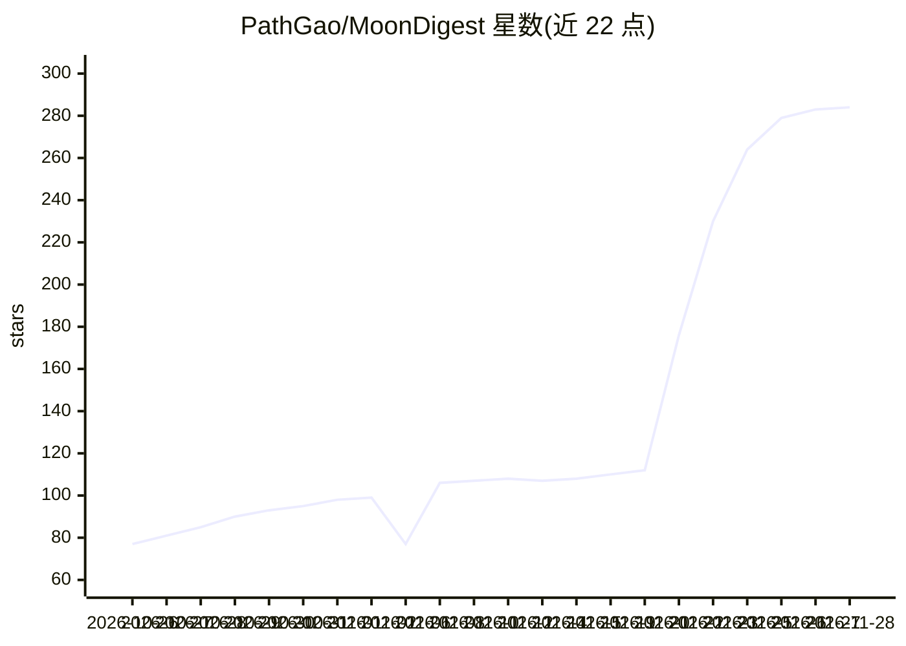

# PathGao/MoonDigest

⭐ 284 · JavaScript · GPL-3.0 · 推送 2026-11-24 · [GitHub](https://github.com/PathGao/MoonDigest) · [官网](https://chromewebstore.google.com/detail/bnjihpbocpimaipifanfkjjpfdbigggd) · 个人维护 · 中文 README

**用 AI 帮用户读完整理 B站/YouTube 收藏视频的 Chrome 扩展**

一个 Chrome MV3 扩展，围绕收藏的视频和网页做三类事：读——查看 B站/YouTube 字幕并复制下载 SRT/TXT，AI 侧边栏生成一句话总结、带时间戳要点并支持追问；理——分拣台按标题和字幕对收藏夹视频给出保留/清理判断，支持打标签与观看进度；记——对话存入摘读记录，导出 Markdown 或写入 Obsidian。AI 调用走用户自配的 API Key（DeepSeek、智谱 GLM、Kimi、MiniMax、OpenRouter 及任意 OpenAI 兼容接口），数据全部存在浏览器本地，无作者服务器。另提供 MCP 服务与 skill，让外部 agent 借浏览器登录态读取字幕并经授权后管理收藏夹。

## 筛选速览

| 维度 | 判定 | 备注 |
|---|---|---|
| AI 角色 | `ai-native` | 本体是模型或模型工具 |
| 许可风险 | `viral` | GPL-3.0 |
| 部署形态 | `library` | 以包/库形式分发 |
| 模型依赖 | locked-api |  |
| 硬件要求 | — | 无带数字的原话,不猜 |
| 安装摩擦 | `low` | 无编译、无系统依赖或容器化 |
| 成熟度 | — | 结构信号不足 |

## 能力要点

- AI 视频总结与追问：一句话总结、带时间戳要点，无字幕时用简介和热门评论兜底
- 分拣台 AI 判断收藏夹视频留/清/拿不准，取消收藏可撤销
- 支持多个 AI 平台配置与切换，兼容任意 OpenAI 接口
- 提供 MCP 服务与 skill 两种接入方式供 AI agent 读取视频内容

## 适用场景

- 批量清理 B站收藏夹里囤积没看的视频
- 看视频前先读 AI 要点决定是否值得看
- 把视频笔记导出 Markdown 归档到 Obsidian
- 让 AI agent 借浏览器登录态读视频字幕做资料调研

## 场景标签

 · 领域:效率/知识管理

## 证据(README 行号)

> L12: 收藏了的视频、想读的网页，MoonDigest 帮你用 AI 读完、整理好。数据都留在你的浏览器里，没有作者的服务器。
> L21: 2. 设置 → 「AI 平台」 → 「+ 添加平台」，选预设，填 API Key，点「测试连接」。浏览器问能否访问这个地址时点允许。设置改了就存，不用点保存。支持 DeepSeek、智谱 GLM、Kimi、MiniMax、Open
> L35: - 分拣台：AI 先看标题、再读字幕，告诉你收藏夹里每个视频值得留、可清理还是拿不准，再由你保留或取消收藏。**取消收藏会真的在 B站取消**，按 U 可以撤销。详见 分拣台说明。

## 星数曲线

2026-10-26 77 → 2026-11-28 284（+207）

---
*卡片 v1 · prompt 1.4 · 生成 2026-11-28 · 置信度 high · 依据 README sha `d055f2e70d82` · [字段定义](../../DATASET.md)*
