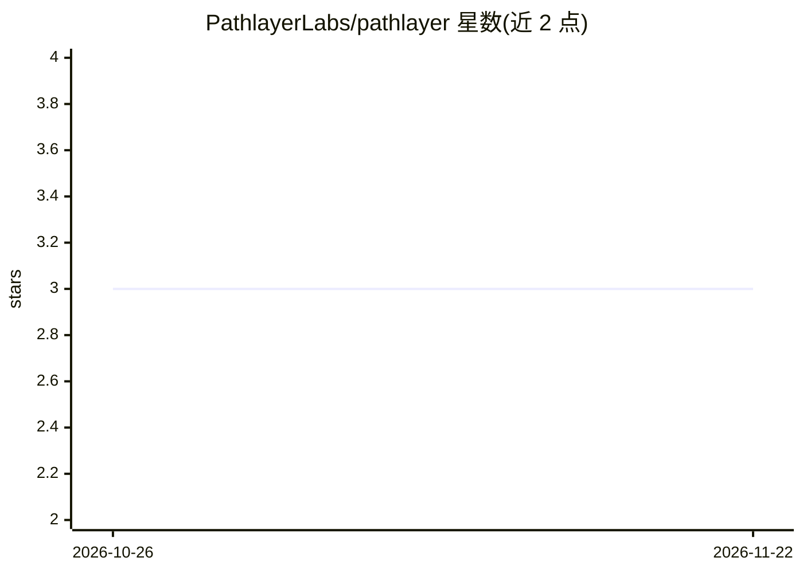

# PathlayerLabs/pathlayer

⭐ 3 · Python · Apache-2.0 · 推送 2026-11-20 · [GitHub](https://github.com/PathlayerLabs/pathlayer) · 组织维护

**AI Agent 运行时守护层：检测循环、重试与成本失控并干预**

以 Python 库形式提供的本地优先运行时层：在 Agent 执行期间观察工具调用事件，用确定性检测器识别循环、重复失败、无进展与预算/时长/内存超限，并按 warn→summarize→fallback→escalate→stop 的分级动作干预；检测不依赖另一个 LLM，而以测试结果、退出码、Git diff 等外部进展证据为依据。通过适配器接入 LangGraph 与 OpenClaw，检测器本地运行，无需云账号、API key 或网络调用。项目处于 alpha 阶段，FALLBACK 与 ESCALATE 动作尚未实现。

## 筛选速览

| 维度 | 判定 | 备注 |
|---|---|---|
| AI 角色 | `ai-ecosystem` | LLM/agent 周边工具 |
| 许可风险 | `permissive` | Apache-2.0 |
| 部署形态 | `library` | 以包/库形式分发 |
| 模型依赖 | — | README 未给出锁定关系 |
| 硬件要求 | — | 无带数字的原话,不猜 |
| 安装摩擦 | `low` | 无编译、无系统依赖或容器化 |
| 成熟度 | `idea` | |

## 能力要点

- 确定性检测器本地运行，检测环节无需额外 LLM、API key 或网络调用
- 分级干预动作 warn→summarize→fallback→escalate→stop，LangGraph 支持 WARN/SUMMARIZE/STOP
- 无原生进展判据的任务可用 checkpoint_set 契约与外部 probe 定义进展
- 为编码任务提供契约编译器，将测试改进等检查点编译为可运行 probe

## 适用场景

- LangGraph Agent 卡在循环或无效重试时自动停止运行
- 给编码 Agent 声明进展契约，区分有效修复与无效改动
- 对 Agent 运行设置预算、时长与内存的硬上限

## 场景标签

`LLM 可观测性` · 领域:评测与运维

## 证据(README 行号)

> L8: Pathlayer is an open-source, local-first runtime layer that detects unproductive
> L16: `warn -> summarize -> fallback -> escalate -> stop`. LangGraph currently
> L75: python -m pip install pathlayer

## 星数曲线

2026-10-26 3 → 2026-11-22 3（+0）

---
*卡片 v1 · prompt 1.4 · 生成 2026-11-22 · 置信度 high · 依据 README sha `6ead29312c0c` · [字段定义](../../DATASET.md)*
