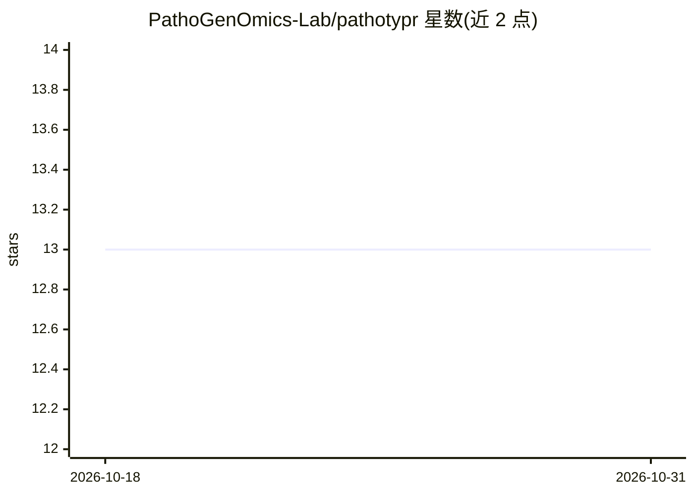

# PathoGenOmics-Lab/pathotypr

⭐ 13 · JavaScript · AGPL-3.0 · 推送 2026-10-24 · [GitHub](https://github.com/PathoGenOmics-Lab/pathotypr) · [官网](https://pathogenomics-lab.github.io/pathotypr/) · 组织维护

**微生物基因组分型与谱系分类工具（结核分枝杆菌复合群）**

Rust 编写的微生物基因组分型工具包：用随机森林分类器将基因组划分谱系，并按用户提供的 SNP 标记面板进行基因分型；输入支持组装基因组（FASTA）与原始测序读段（FASTQ），可单机笔记本运行，附带原生桌面 GUI。提供 train/predict/classify/split-fastq/match 五个子命令，并在 Zenodo 发布结核分枝杆菌复合群的现成标记面板与预训练模型。仅经 MTBC 验证，其他生物属探索性使用。

## 筛选速览

| 维度 | 判定 | 备注 |
|---|---|---|
| AI 角色 | `ai-native` | 本体是模型或模型工具 |
| 许可风险 | `viral` | AGPL-3.0 |
| 部署形态 | `None` |  |
| 模型依赖 | — | README 未给出锁定关系 |
| 硬件要求 | — | 无带数字的原话,不猜 |
| 安装摩擦 | `low` | 无编译、无系统依赖或容器化 |
| 成熟度 | `idea` | |

## 能力要点

- 随机森林谱系分类器（train/predict）
- SNP 标记驱动的基因分型，支持组装与原始 reads
- 无比对（alignment-free）的 FASTQ 基因分型
- Zenodo 提供 MTBC 标记面板与预训练模型（3,707 个谱系 SNP、WHO 耐药目录）

## 适用场景

- 对结核分枝杆菌复合群基因组做谱系鉴定与耐药标记检测
- 用带标签基因组训练自定义谱系分类模型
- 公共卫生基因组监测中对大量分离株做分型

## 场景标签

 · 领域:生物信息学/病原基因组学

## 证据(README 行号)

> L23: pathotypr is a Rust toolkit that classifies microbial genomes into lineages and genotypes them against user-defined
> L29: |**`train`**|Build a Random Forest classifier from labeled genomes|FASTA|docs|

## 星数曲线

2026-10-18 13 → 2026-10-31 13（+0）

---
*卡片 v1 · prompt 1.4 · 生成 2026-10-31 · 置信度 high · 依据 README sha `b137b5d03057` · [字段定义](../../DATASET.md)*
