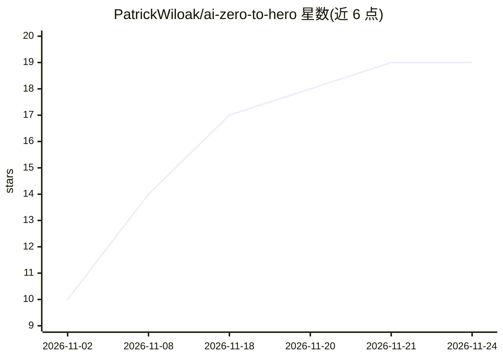

# PatrickWiloak/ai-zero-to-hero

⭐ 20 · Python · CC-BY-4.0 · 推送 2026-11-23 · [GitHub](https://github.com/PatrickWiloak/ai-zero-to-hero) · [官网](https://ai.noblerworks.com/) · 组织维护

**免费 AI 学习资源库：156 篇论文白话解读 + 学习/应用/治理指南**

Nobler Works 维护的 AI 知识仓库，由六大指南板块组成：Learn（按受众的学习路径与基础概念）、AI at Work（按角色划分的实践手册与团队推广）、Build（动手项目如聊天机器人、RAG、MCP agent）、Tools 选型、Safety & Governance 与 Careers，另含 Anthropic/NVIDIA/AWS/Azure 等厂商 AI 认证备考指南。核心为研究图书馆：156 篇 AI 影响力论文的白话摘要与 31 篇解释文档，按类别与 68 个主题标签组织，配 papers.json/papers.csv 机器可读清单与生成脚本，可通过网站 ai.noblerworks.com 阅读。

## 筛选速览

| 维度 | 判定 | 备注 |
|---|---|---|
| AI 角色 | `ai-knowledge` | 知识聚合/清单类 |
| 许可风险 | `viral` | CC-BY-4.0 |
| 部署形态 | `None` |  |
| 模型依赖 | — | README 未给出锁定关系 |
| 硬件要求 | — | 无带数字的原话,不猜 |
| 安装摩擦 | `low` | 无编译、无系统依赖或容器化 |
| 成熟度 | — | 结构信号不足 |

## 能力要点

- 156 篇 AI 论文的白话摘要，按类别与 68 个主题标签组织
- 31 篇 Explainers 覆盖模型家族、基准、算力成本与政策
- 六大指南板块：学习、工作应用、构建项目、工具选型、安全治理、职业
- 8 家厂商 AI 认证的备考指南与可导入 Anki 的闪卡

## 适用场景

- 从零开始系统学习 AI 概念与研究脉络
- 为 Anthropic/AWS/Azure 等 AI 认证考试备考
- 在工作中引入 AI 或向团队推广时查找按角色的实践手册
- 快速理解某篇经典论文讲了什么、为什么重要

## 场景标签

`教程课程` `精选清单` · 领域:学习与行业

## 证据(README 行号)

> L49: **Everything AI in one place, free.** Six guide pillars take you from zero to hero - **Learn** (paths by audience, 
> L51: Underneath sits the research library: the **156 most influential papers** and landmark essays that shaped modern AI
> L86: - 🧭 **Explainers** - 31 dated pages on model families, benchmarks, concepts, compute, policy, the ecosystem and ope

## 星数曲线

2026-11-02 10 → 2026-11-24 19（+9）

---
*卡片 v1 · prompt 1.4 · 生成 2026-11-18 · 置信度 high · 依据 README sha `0d1dfd5ddfba` · [字段定义](../../DATASET.md)*
