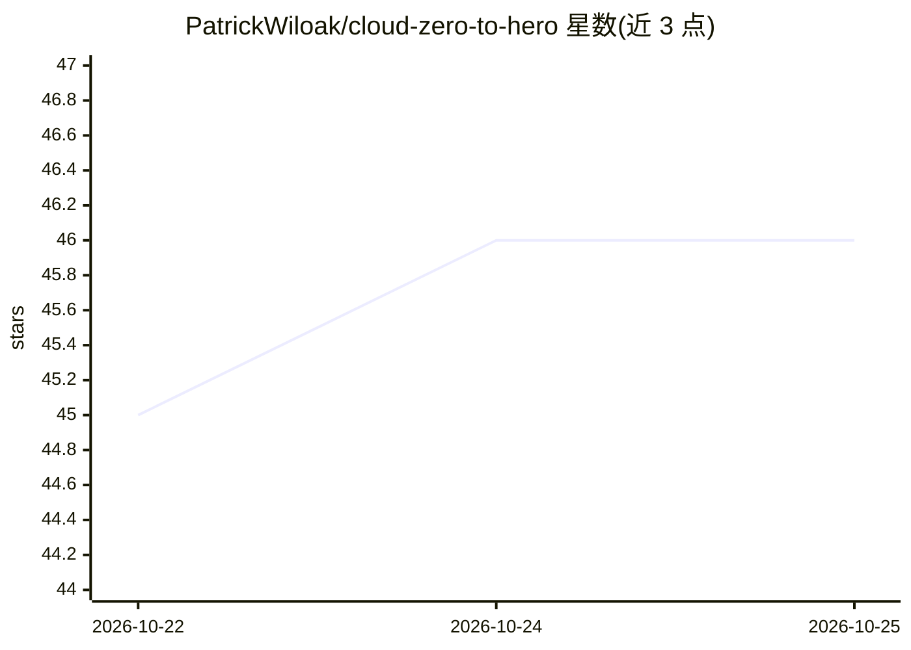

# PatrickWiloak/cloud-zero-to-hero

⭐ 46 · HTML · CC-BY-4.0 · 推送 2026-10-22 · [GitHub](https://github.com/PatrickWiloak/cloud-zero-to-hero) · [官网](https://cloud.noblerworks.com/) · 组织维护

**云计算学习与认证备考知识库：72 个认证指南加动手项目**

由 Nobler Works 维护的开源云计算学习资源库，覆盖 AWS、Azure、GCP、OCI、IBM Cloud、Kubernetes、Linux、Terraform、DevOps、SRE 与 FinOps。内容按四大支柱组织：32 个白话概念页、8 阶段从零路径、9 个动手项目（3 层应用、CI/CD、K8s、GitOps 等）、72 份跨 16 家厂商的认证学习指南（含 6,000+ 官方文档链接），并提供跨云服务对比、9 份 CLI 速查表与新鲜度台账。同仓库生成的网站提供全文搜索（180 万词）。数据、安全、AI 内容已拆分至三个姊妹站点。

## 筛选速览

| 维度 | 判定 | 备注 |
|---|---|---|
| AI 角色 | `ai-knowledge` | 知识聚合/清单类 |
| 许可风险 | `viral` | CC-BY-4.0 |
| 部署形态 | `None` |  |
| 模型依赖 | — | README 未给出锁定关系 |
| 硬件要求 | — | 无带数字的原话,不猜 |
| 安装摩擦 | `low` | 无编译、无系统依赖或容器化 |
| 成熟度 | — | 结构信号不足 |

## 能力要点

- 72 份认证学习指南覆盖 16 家厂商，含 6,000+ 官方文档链接
- 9 个动手项目与 12 个多云架构模式
- 7 组跨云服务对比（计算/存储/网络/容器等）
- 每份认证附最近核验日期的新鲜度台账

## 适用场景

- 从零开始系统学习云计算并规划认证路径
- 备考 AWS/Azure/GCP/Kubernetes 等云认证
- 对比不同云厂商的同类服务做选型参考
- 按职业路线（云工程师、SRE、平台工程师）查学习地图

## 场景标签

`教程课程` · 领域:学习与行业

## 证据(README 行号)

> L36: > **Cloud from absolute zero to hired: AWS, Azure, GCP, OCI and IBM Cloud, Kubernetes, Linux, networking, Terraform
> L74: |🎯|**Certify**|72 cert study guides across 16 providers. Fact sheets, practice plans, scenarios, practice questions
> L111: - ✅ **72 certification study guides** across 16 providers, 6,000+ embedded vendor doc links

## 星数曲线

2026-10-22 45 → 2026-10-25 46（+1）

---
*卡片 v1 · prompt 1.4 · 生成 2026-10-25 · 置信度 high · 依据 README sha `bd0d49f45841` · [字段定义](../../DATASET.md)*
