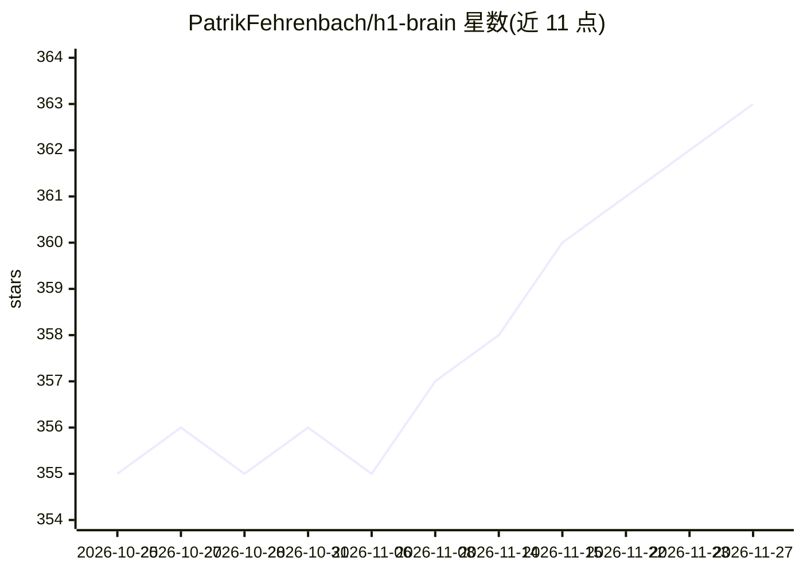

# PatrikFehrenbach/h1-brain

⭐ 363 · Python · MIT · 推送 2026-11-20 · [GitHub](https://github.com/PatrikFehrenbach/h1-brain) · 个人维护

**把 AI 助手接入 HackerOne 的 MCP 服务器，辅助漏洞赏金狩猎**

一个 MCP 服务器，将 AI 助手连接到 HackerOne：通过 API 拉取用户的赏金报告历史、项目范围与报告详情，存入本地 SQLite 数据库，并随仓库附带 3,600+ 条公开披露且获得赏金的报告数据库。暴露 MCP 工具供 Claude Desktop、Claude Code 等客户端调用，主要工具 hack(handle) 一次性汇总新范围、历史发现、公开披露、弱点模式、未测资产并生成攻击简报。需要 Python 3.10+ 与 HackerOne API token，个人数据需先执行 fetch 工具同步。

## 筛选速览

| 维度 | 判定 | 备注 |
|---|---|---|
| AI 角色 | `ai-ecosystem` | LLM/agent 周边工具 |
| 许可风险 | `permissive` | MIT |
| 部署形态 | `library` | 以包/库形式分发 |
| 模型依赖 | — | README 未给出锁定关系 |
| 硬件要求 | — | 无带数字的原话,不猜 |
| 安装摩擦 | `low` | 无编译、无系统依赖或容器化 |
| 成熟度 | — | 结构信号不足 |

## 能力要点

- hack(handle) 单次调用生成完整攻击简报（范围/弱点模式/未测资产/攻击向量）
- 内置 3,600+ 条公开披露的赏金报告数据库，开箱可查询
- 个人数据与公开披露双数据库分离，共提供约 12 个 MCP 工具
- 支持 Claude Desktop 与 Claude Code 两种接入方式

## 适用场景

- 为自己参与的 HackerOne 项目生成攻击简报
- 按弱点类型、严重度检索自己过往的报告
- 搜索社区公开披露报告寻找可借鉴的弱点模式

## 场景标签

`网络安全` · 领域:学习与行业

## 证据(README 行号)

> L3: An MCP server that connects your AI assistant to HackerOne. It pulls your bug bounty history, program scopes, and re
> L146: server.py              MCP server

## 星数曲线

2026-10-25 355 → 2026-11-27 363（+8）

---
*卡片 v1 · prompt 1.4 · 生成 2026-11-25 · 置信度 mid · 依据 README sha `6e9c5dde9ae0` · [字段定义](../../DATASET.md)*
