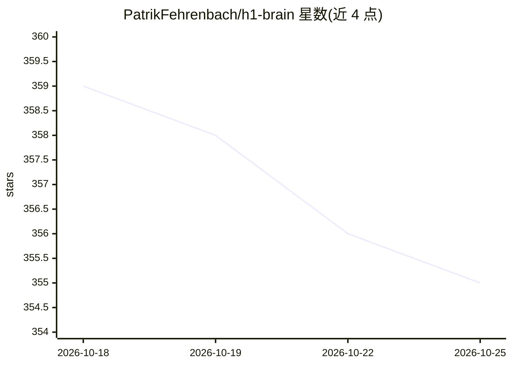

# PatrikFehrenbach/h1-brain

⭐ 355 · Python · MIT · 推送 2026-10-13 · [GitHub](https://github.com/PatrikFehrenbach/h1-brain) · 个人维护

**连接 AI 助手与 HackerOne 的 MCP 服务器，辅助漏洞赏金**

面向漏洞赏金研究者的 MCP server：通过 HackerOne API 拉取个人报告、项目范围与活动时间线到本地 SQLite，并内置 3,600+ 公开已付赏金报告数据库。提供十余个 MCP 工具用于检索、同步数据，核心工具 hack(handle) 一次性生成攻击简报——含最新范围、个人历史发现、弱点模式、未触及资产与建议攻击向量。需 Python 3.10+ 与 HackerOne API token，支持 Claude Desktop / Claude Code 等 MCP 客户端接入。

## 筛选速览

| 维度 | 判定 | 备注 |
|---|---|---|
| AI 角色 | `ai-ecosystem` | LLM/agent 周边工具 |
| 许可风险 | `permissive` | MIT |
| 部署形态 | `library` | 以包/库形式分发 |
| 模型依赖 | — | README 未给出锁定关系 |
| 硬件要求 | — | 无带数字的原话,不猜 |
| 安装摩擦 | `low` | 无编译、无系统依赖或容器化 |
| 成熟度 | — | 结构信号不足 |

## 能力要点

- 内置 3,600+ 公开赏金报告的 SQLite 数据库，开箱可查
- hack(handle) 单次调用生成含范围、弱点模式与建议攻击向量的攻击简报
- 个人数据库与公开报告库分离，支持全文检索与报告时间线导出

## 适用场景

- 让 Claude 等客户端检索我的历史赏金报告与项目范围
- 针对某个目标程序生成汇总弱点模式与未触及资产的攻击简报
- 全文检索社区公开披露的漏洞报告

## 场景标签

`网络安全` `语义搜索` · 领域:知识与检索

## 证据(README 行号)

> L3: An MCP server that connects your AI assistant to HackerOne. It pulls your bug bounty history, program scopes, and re
> L146: server.py              MCP server

## 星数曲线

2026-10-18 359 → 2026-10-25 355（-4）

---
*卡片 v1 · prompt 1.4 · 生成 2026-10-21 · 置信度 mid · 依据 README sha `531e07af1eb7` · [字段定义](../../DATASET.md)*
