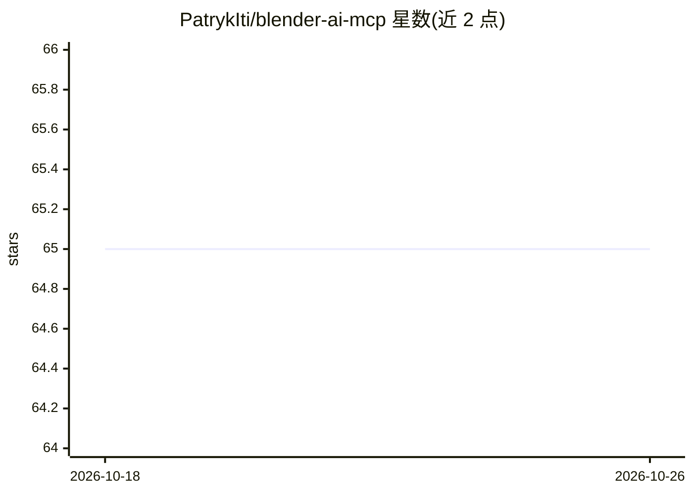

# PatrykIti/blender-ai-mcp

⭐ 65 · Python · Apache-2.0 · 推送 2026-10-12 · [GitHub](https://github.com/PatrykIti/blender-ai-mcp) · 个人维护

**供 MCP 客户端控制 Blender 的 MCP 服务器（已停止维护）**

面向 Claude、ChatGPT、Codex 等 MCP 客户端的 Blender 控制服务器：通过带参数校验的稳定工具 API 调用 Blender，替代让模型直接生成 bpy 脚本。机制包括以 router_set_goal 为起点的目标优先会话、小而可搜索的引导层（llm-guided）、宏工具层、确定性检查/测量/断言作为真值层，以及可插拔视觉运行时（本地 MLX、OpenRouter、Gemini）。架构上 Blender 插件在主线程执行操作，MCP 服务器负责路由与校验。README 顶部声明项目已停止维护，将由新方案替代。

## 筛选速览

| 维度 | 判定 | 备注 |
|---|---|---|
| AI 角色 | `ai-ecosystem` | LLM/agent 周边工具 |
| 许可风险 | `permissive` | Apache-2.0 |
| 部署形态 | `desktop` | 安装包/桌面程序 |
| 模型依赖 | — | README 未给出锁定关系 |
| 硬件要求 | — | 无带数字的原话,不猜 |
| 安装摩擦 | `low` | 无编译、无系统依赖或容器化 |
| 成熟度 | — | 结构信号不足 |

## 能力要点

- 稳定工具契约替代脚本生成，参数经校验
- 目标优先路由（router_set_goal）与搜索优先的小型引导层
- 确定性检查/测量/断言工具作为真值层，视觉仅辅助
- 可插拔视觉运行时：本地 MLX（Qwen VL 4B 级）、OpenRouter、Gemini

## 适用场景

- 让 MCP 客户端（Claude/ChatGPT 等）安全控制 Blender 建模
- 在建模流程中用确定性断言核验场景状态
- 通过参考图与阶段比对做迭代式造型工作

## 场景标签

`GUI 自动化` · 领域:效率与自动化

## 证据(README 行号)

> L15: `blender-ai-mcp` lets Claude, ChatGPT, Codex, and other MCP clients control Blender through a stable tool API inste
> L49: - **Pluggable vision runtimes** now cover local MLX plus external OpenRouter and Google AI Studio / Gemini provider

## 星数曲线

2026-10-18 65 → 2026-10-26 65（+0）

---
*卡片 v1 · prompt 1.4 · 生成 2026-10-24 · 置信度 high · 依据 README sha `f770ef862df8` · [字段定义](../../DATASET.md)*
