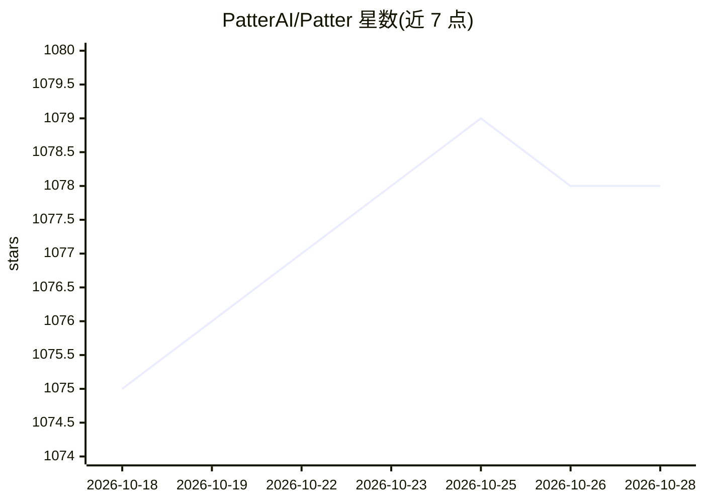

# PatterAI/Patter

⭐ 1,079 · Python · MIT · 推送 2026-10-03 · [GitHub](https://github.com/PatterAI/Patter) · [官网](https://getpatter.com) · 组织维护

**给 AI agent 配电话号码的开源语音 SDK（Python/TypeScript）**

开源 SDK，位于用户构建的 agent 与电话网络之间，负责 agent 循环、LLM、语音识别、语音合成、实时语音、音频处理与电话运营商接入。LLM/STT/TTS/Realtime/运营商各层提供 27+ 供应商集成并可一行切换，支持 Realtime、Pipeline、Hybrid 三种语音模式；含 LLM 故障转移链、工具调用、呼叫转移、guardrails 与 OpenTelemetry 追踪。本地可运行内置 tunnel 与 dashboard，也可在终端模拟整通呼叫。Python 与 TypeScript 双 SDK 界面一致，MIT 许可。

## 筛选速览

| 维度 | 判定 | 备注 |
|---|---|---|
| AI 角色 | `ai-ecosystem` | LLM/agent 周边工具 |
| 许可风险 | `permissive` | MIT |
| 部署形态 | `library` | 以包/库形式分发 |
| 模型依赖 | locked-api |  |
| 硬件要求 | — | 无带数字的原话,不猜 |
| 安装摩擦 | `low` | 无编译、无系统依赖或容器化 |
| 成熟度 | — | 结构信号不足 |

## 能力要点

- Python 与 TypeScript 双 SDK，界面完全对齐
- LLM/STT/TTS/Realtime/运营商各层 27+ 供应商可切换
- 内置 tunnel、dashboard 与无电话的终端呼叫模拟
- 呼叫中 LLM 供应商故障转移与 OpenTelemetry 追踪

## 适用场景

- 为自建 AI agent 接入 Twilio/Telnyx/Plivo 电话线路
- 本地开发调试语音 agent 并模拟完整通话
- 按层挑选供应商组合自定义语音管线

## 场景标签

`语音 Agent` · 领域:对话与助手

## 证据(README 行号)

> L20: **Patter** is the open-source SDK that gives your AI agent a phone number. You build the agent; Patter handles ever
> L28: Patter is the **full voice stack** between your application and the phone network — not just glue between an LLM an

## 星数曲线

2026-10-18 1,075 → 2026-10-28 1,078（+3）

---
*卡片 v1 · prompt 1.4 · 生成 2026-10-21 · 置信度 high · 依据 README sha `ed2b754c9014` · [字段定义](../../DATASET.md)*
