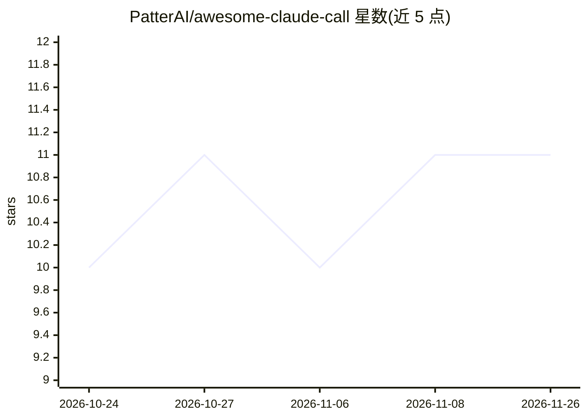

# PatterAI/awesome-claude-call

⭐ 11 · TypeScript · MIT · 推送 2026-05-10 · [GitHub](https://github.com/PatterAI/awesome-claude-call) · [官网](https://patterai.github.io/awesome-claude-call/) · 组织维护

**给 Claude Code 接入真实电话能力的插件（外呼/呼入/完成通知）**

一个 Claude Code 插件，捆绑一个基于 Patter SDK 的 MCP server，为 Claude 会话提供真实电话呼叫：外呼（Claude 拨打第三方并按目标协商后返回结构化结果）、Stop hook 完成回拨（任务结束后致电用户并播报摘要）、呼入（拨打 Twilio 号码直接进入语音会话）。通过斜杠命令与 phone-agent 子代理驱动；电话号码日志脱敏至末四位、凭据存于 0600 权限文件、外呼首回合内置 AI 披露。依赖 Twilio 账号与 OpenAI API key，支持 Claude Code 2.0+、Node 20+，macOS 或 Linux（Windows 仅 WSL 未测试）。

## 筛选速览

| 维度 | 判定 | 备注 |
|---|---|---|
| AI 角色 | `ai-native` | 本体是模型或模型工具 |
| 许可风险 | `permissive` | MIT |
| 部署形态 | `library` | 以包/库形式分发 |
| 模型依赖 | locked-api |  |
| 硬件要求 | — | 无带数字的原话,不猜 |
| 安装摩擦 | `medium` | 含编译或系统依赖之一 |
| 成熟度 | — | 结构信号不足 |

## 能力要点

- 三种通话流：外呼、任务完成回拨、呼入接入当前会话
- 捆绑约 800 行 TypeScript 的 MCP server，直接封装 getpatter SDK，无需额外 npm install
- Cloudflare 隧道在首次外呼时懒启动，免手动 webhook 配置
- 凭据文件 mode 0600、日志电话号码脱敏、外呼首回合硬编码 AI 披露

## 适用场景

- 让 Claude 自动拨打第三方电话预订/确认事项并带回结果
- 长任务跑完后自动接到电话摘要并可语音追问
- 外出时拨入自己的 Twilio 号码与正在运行的会话对话

## 场景标签

`语音 Agent` · 领域:对话与助手

## 证据(README 行号)

> L10:  Give Claude Code a phone number.
> L13:  A Claude Code plugin that bundles an MCP server built on Patter. The plugin layer holds no voice code &mdash; it c
> L21: |**Claude &rarr; third party**|Outbound. Claude dials, negotiates against an objective, and returns a structured ou

## 星数曲线

2026-10-24 10 → 2026-11-26 11（+1）

---
*卡片 v1 · prompt 1.4 · 生成 2026-11-18 · 置信度 low · 依据 README sha `c4b1c83c7a27` · [字段定义](../../DATASET.md)*
