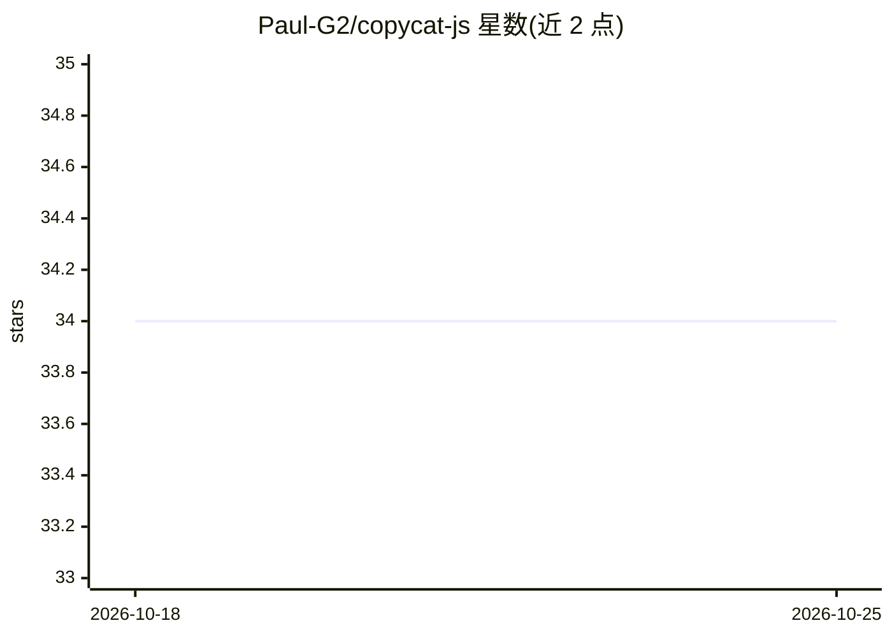

# Paul-G2/copycat-js

⭐ 34 · JavaScript · MIT · 推送 2026-04-15 · [GitHub](https://github.com/Paul-G2/copycat-js) · [官网](https://paul-g2.github.io/copycat-js/) · 个人维护

**Hofstadter Copycat 类比推理程序的 JavaScript 复刻实现**

将 Douglas Hofstadter 与 Melanie Mitchell 开发的 Copycat 程序移植为 JavaScript。Copycat 是人类类比思维的计算机模型，用于求解形如 "abc 之于 abd 如同 ijk 之于什么" 的字母字符串谜题。移植主要基于 Lucas Saldyt 的 Python 版本，UI 外观参考 James Marshall 的 Metacat。作者因原演示不易运行而做此复刻，配有在线试用链接。理论细节见《Fluid Concepts and Creative Analogies》与《Analogy-Making as Perception》两书。README 未给出安装或运行命令。

## 筛选速览

| 维度 | 判定 | 备注 |
|---|---|---|
| AI 角色 | `ai-native` | 本体是模型或模型工具 |
| 许可风险 | `permissive` | MIT |
| 部署形态 | `None` |  |
| 模型依赖 | — | README 未给出锁定关系 |
| 硬件要求 | — | 无带数字的原话,不猜 |
| 安装摩擦 | `low` | 无编译、无系统依赖或容器化 |
| 成熟度 | — | 结构信号不足 |

## 能力要点

- Copycat 类比推理模型的 JavaScript 移植实现
- 求解字母字符串类比谜题
- 提供在线试用链接
- 移植自 Python 版本，UI 参考 Metacat

## 适用场景

- 在线体验或本地研究 Copycat 类比推理过程
- 认知科学课程中演示人类类比思维模型

## 场景标签

 · 领域:认知科学/符号AI

## 证据(README 行号)

> L9: Copycat is a computer model of human analogy-making.
> L10: It tries to solve letter puzzles of the form " abc is to abd as ijk is to what?"

## 星数曲线

2026-10-18 34 → 2026-10-25 34（+0）

---
*卡片 v1 · prompt 1.4 · 生成 2026-10-25 · 置信度 mid · 依据 README sha `436b089d514a` · [字段定义](../../DATASET.md)*
