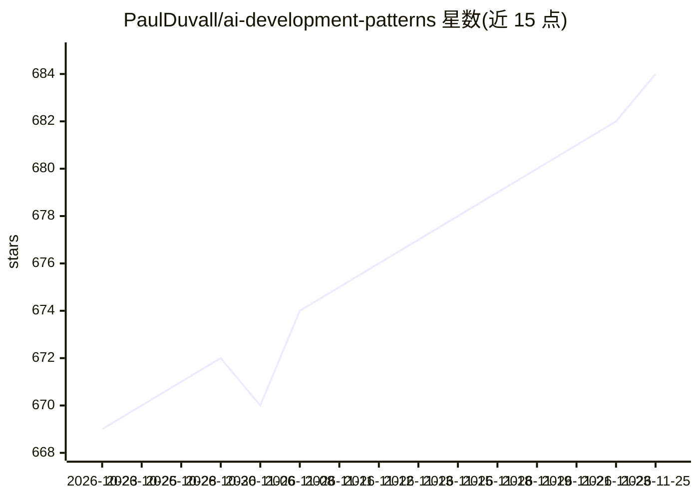

# PaulDuvall/ai-development-patterns

⭐ 684 · Python · MIT · 推送 2026-11-23 · [GitHub](https://github.com/PaulDuvall/ai-development-patterns) · [官网](https://paulduvall.github.io/ai-development-patterns/) · 个人维护

**面向团队用 AI 辅助开发软件的模式目录**

按实施成熟度与开发生命周期阶段组织的 AI 辅助开发模式集合，分为 Foundation、Development、Operations 及 Experimental 四类，覆盖团队就绪评估、编码规则固化、安全沙箱、CI/CD 与运维管理等模式。内容以 Harness Engineering、Loop Engineering、Lifecycle 三个视角组织，并提供模式依赖图与实现顺序说明。采用 MIT 许可，模式内容随领域发展更新，含反模式与可运行示例。

## 筛选速览

| 维度 | 判定 | 备注 |
|---|---|---|
| AI 角色 | `ai-knowledge` | 知识聚合/清单类 |
| 许可风险 | `permissive` | MIT |
| 部署形态 | `None` |  |
| 模型依赖 | — | README 未给出锁定关系 |
| 硬件要求 | — | 无带数字的原话,不猜 |
| 安装摩擦 | `low` | 无编译、无系统依赖或容器化 |
| 成熟度 | — | 结构信号不足 |

## 能力要点

- 三阶段模式分类：Foundation/Development/Operations，附模式依赖与学习顺序图
- Harness Engineering 视角：以 feedforward/feedback 与 computational/inferential 控制分类模式
- Loop Engineering 视角：界定自治循环的边界、验证与仲裁原则
- 采用 CI 做确定性 schema、溯源、链接与新鲜度检查

## 适用场景

- 团队评估引入 AI 辅助开发的就绪程度并选择首批模式
- 为编码代理建立规则、沙箱与验证等控制机制
- 按生命周期阶段规划 AI 辅助开发的流程与检查点

## 场景标签

 · 领域:软件工程/开发方法

## 证据(README 行号)

> L12: A comprehensive collection of patterns based on my experience for building software with AI assistance, organized b
> L33: - **Foundation Patterns** - Essential patterns for team readiness and basic AI integration
> L35: - **Operations Patterns** - CI/CD, security, and production management with AI

## 星数曲线

2026-10-23 669 → 2026-11-25 684（+15）

---
*卡片 v1 · prompt 1.4 · 生成 2026-11-24 · 置信度 high · 依据 README sha `87467926a5df` · [字段定义](../../DATASET.md)*
