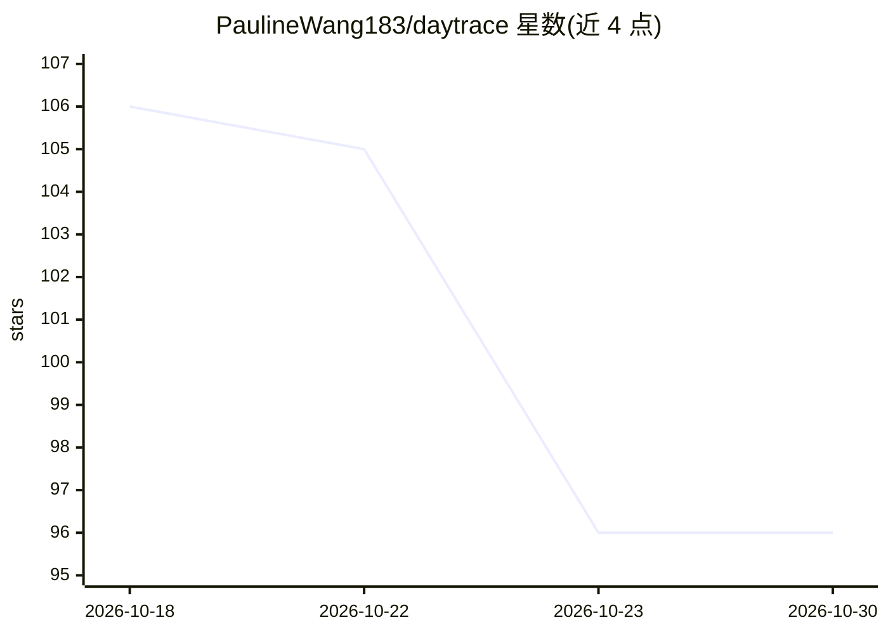

# PaulineWang183/daytrace

⭐ 96 · Python · MIT · 推送 2026-08-28 · [GitHub](https://github.com/PaulineWang183/daytrace) · 个人维护 · 中文 README

**面向学生与知识工作者的本地优先 AI 桌面时间规划助手**

Electron + Flask + SQLite 构建的 macOS（Apple Silicon）桌面应用：用户用自然语言表达目标（如面试、考研、跑步），AI 结合已有日程、长期目标与个人节奏生成可执行安排，写入前进行冲突校验；支持动态重排、每日复盘与偏好记忆。模型服务由用户自行配置 OpenAI 兼容接口，数据存本机 SQLite；AI 不可用时仍可查看并手动创建日程。当前未签名 DMG 仅用于内测，公开分发前需完成 Apple 签名与公证。

## 筛选速览

| 维度 | 判定 | 备注 |
|---|---|---|
| AI 角色 | `ai-native` | 本体是模型或模型工具 |
| 许可风险 | `permissive` | MIT |
| 部署形态 | `None` |  |
| 模型依赖 | — | README 未给出锁定关系 |
| 硬件要求 | — | 无带数字的原话,不猜 |
| 安装摩擦 | `low` | 无编译、无系统依赖或容器化 |
| 成熟度 | `idea` | |

## 能力要点

- 自然语言创建/修改/删除日程并生成无冲突专注块
- 长期目标拆解为阶段、子任务与日历安排，含截止风险提示
- 冲突校验与动态重排，复盘反馈回写计划
- 数据本地 SQLite 存储，API Key 存 macOS 钥匙串

## 适用场景

- 把考研、求职等长期目标拆成可执行的阶段计划
- 临时变化或任务延期后自动重新安排剩余计划
- 本地保存日程与偏好数据的 AI 日程管理

## 场景标签

`AI 助手` · 领域:对话与助手

## 证据(README 行号)

> L5: Daytrace 是一款面向学生与知识工作者的本地优先 AI 桌面时间规划助手。
> L7: 当用户说“我三天后有产品面试”“12 月底要考研”“今晚想跑步”，Daytrace 不会只创建一个日历事件。它会结合已有日程、长期目标、个人节奏与执行反馈，给出真正可执行的安排；对于涉及取舍的复杂规划，会先生成方案并在写入前进行冲突
> L86: - 用户自行配置 OpenAI 兼容模型服务。

## 星数曲线

2026-10-18 106 → 2026-10-30 96（-10）

---
*卡片 v1 · prompt 1.4 · 生成 2026-10-23 · 置信度 high · 依据 README sha `a8ad6cf6f6fd` · [字段定义](../../DATASET.md)*
