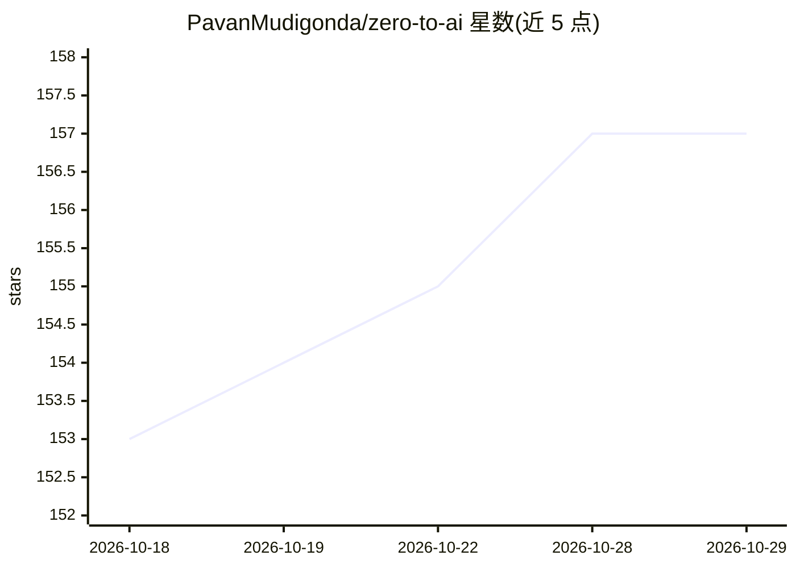

# PavanMudigonda/zero-to-ai

⭐ 157 · Jupyter Notebook · MIT · 推送 2026-10-25 · [GitHub](https://github.com/PavanMudigonda/zero-to-ai) · [官网](https://zero-to-ai.dev) · 个人维护

**免费开源 AI/ML 课程：950+ Jupyter 笔记本覆盖入门到进阶**

面向学习者的免费开源 AI/ML 课程仓库，以 33 个编号阶段组织 950+ 个 Jupyter 笔记本，覆盖 Python、数据科学、深度学习、LLM、RAG、AI Agent、提示工程、微调与 MLOps。内容以 MDX 形式发布到 zero-to-ai.dev 站点，支持浏览器内经 Pyodide 零安装运行，并提供 Colab/Kaggle/Codespaces/Replit/SageMaker Studio Lab 等云端途径。核心路径已成熟，部分后期阶段（如推理优化）仍在建设中。内容整合自 Microsoft Learn、Stanford 课程、Karpathy、Fast.ai 等来源。

## 筛选速览

| 维度 | 判定 | 备注 |
|---|---|---|
| AI 角色 | `ai-knowledge` | 知识聚合/清单类 |
| 许可风险 | `permissive` | MIT |
| 部署形态 | `library` | 以包/库形式分发 |
| 模型依赖 | — | README 未给出锁定关系 |
| 硬件要求 | — | 无带数字的原话,不猜 |
| 安装摩擦 | `low` | 无编译、无系统依赖或容器化 |
| 成熟度 | `idea` | |

## 能力要点

- 950+ Jupyter 笔记本、33 个阶段的编号课程结构
- 浏览器内零安装运行（Pyodide），无需 GPU
- 提供 Colab/Kaggle/Codespaces/Replit 等多种云端运行途径
- 提供 4 条按目标区分的学习路径（4-6 周到 4-6 个月）

## 适用场景

- 零基础系统学习 Python 到 LLM/RAG/Agent 的完整路径
- 数据科学/ML 求职方向的分阶段学习
- 低配设备或手机上直接在浏览器运行笔记本

## 场景标签

`教程课程` · 领域:学习与行业

## 证据(README 行号)

> L3: Zero to AI is a free, open-source AI course and machine learning curriculum for learning Python, data science, deep 
> L5: Use the live site for the guided learning experience at zero-to-ai.dev, and use this GitHub repo as the source curri

## 星数曲线

2026-10-18 153 → 2026-10-29 157（+4）

---
*卡片 v1 · prompt 1.4 · 生成 2026-10-22 · 置信度 mid · 依据 README sha `0fd549fa55e6` · [字段定义](../../DATASET.md)*
