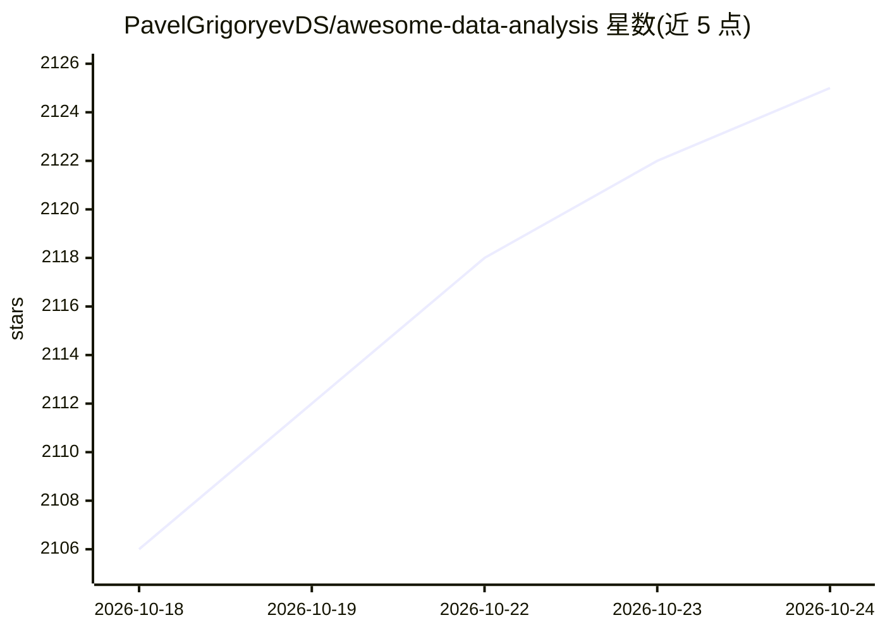

# PavelGrigoryevDS/awesome-data-analysis

⭐ 2,128 · CC0-1.0 · 推送 2026-08-09 · [GitHub](https://github.com/PavelGrigoryevDS/awesome-data-analysis) · [官网](https://pavelgrigoryevds.github.io/awesome-data-analysis/) · 个人维护

**数据分析与数据科学资源策展清单（500+ 条，多分类）**

以 awesome-list 形式收录数据分析与数据科学相关资源 500 余条，按学习路线图、Python 工具、SQL 与数据库、自动化 EDA 与可视化、数据校验、特征工程等主题分类组织；条目涵盖教程、路线图、速查表、面试准备、开源工具库与数据库系统，面向初学者到有经验的从业者。内容为链接聚合，提供 Web 版阅读入口，采用 CC0 许可，接受 PR 与 Discussions 建议。

## 筛选速览

| 维度 | 判定 | 备注 |
|---|---|---|
| AI 角色 | `ai-knowledge` | 知识聚合/清单类 |
| 许可风险 | `viral` | CC0-1.0 |
| 部署形态 | `self-host` | docker 或自建部署 |
| 模型依赖 | — | README 未给出锁定关系 |
| 硬件要求 | — | 无带数字的原话,不猜 |
| 安装摩擦 | `low` | 无编译、无系统依赖或容器化 |
| 成熟度 | — | 结构信号不足 |

## 能力要点

- 500+ 条资源覆盖 Python 工具、SQL、路线图、速查表与面试准备
- 按数据操作、自动化 EDA、数据质量、特征工程、数据库等细分类目组织
- 收录 PandasAI、EverSQL 等 LLM/AI 相关数据分析工具条目

## 适用场景

- 系统性地查找数据分析学习路线与教程资源
- 按类目挑选数据处理、可视化与数据校验的 Python 工具库
- 比较和选型开源数据库（OLAP、时序、图、文档等）

## 场景标签

`精选清单` · 领域:学习与行业

## 证据(README 行号)

> L7: 500+ curated resources for data analysis and data science: tools, libraries, roadmaps, cheatsheets, interview guides
> L17: ## 📑 Contents
> L21: ## 🏆 Awesome Data Science Repositories

## 星数曲线

2026-10-18 2,106 → 2026-10-24 2,125（+19）

---
*卡片 v1 · prompt 1.4 · 生成 2026-10-21 · 置信度 mid · 依据 README sha `02778acd86bb` · [字段定义](../../DATASET.md)*
