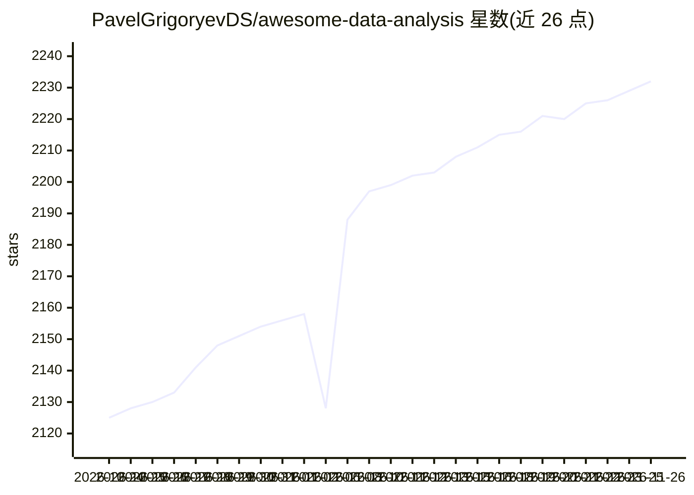

# PavelGrigoryevDS/awesome-data-analysis

⭐ 2,232 · CC0-1.0 · 推送 2026-11-01 · [GitHub](https://github.com/PavelGrigoryevDS/awesome-data-analysis) · [官网](https://pavelgrigoryevds.github.io/awesome-data-analysis/) · 个人维护

**数据分析与数据科学资源清单：收录 500+ 工具、教程与学习路径**

一个按类别组织的 curated list，收录数据科学与数据分析领域的资源：学习路线图、Python/Pandas/NumPy 教程、自动化 EDA 与可视化工具、数据质量与特征工程库、SQL 教程及多种数据库系统列表。面向从零基础到专业不同阶段的学习者，提供学习路径、练习资源与工具索引。以 Markdown 清单形式维护，提供网页版阅读界面，接受社区 PR 与讨论区建议，采用 CC0 许可。

## 筛选速览

| 维度 | 判定 | 备注 |
|---|---|---|
| AI 角色 | `ai-knowledge` | 知识聚合/清单类 |
| 许可风险 | `viral` | CC0-1.0 |
| 部署形态 | `self-host` | docker 或自建部署 |
| 模型依赖 | — | README 未给出锁定关系 |
| 硬件要求 | — | 无带数字的原话,不猜 |
| 安装摩擦 | `low` | 无编译、无系统依赖或容器化 |
| 成熟度 | — | 结构信号不足 |

## 能力要点

- 收录 500+ 数据分析与数据科学资源
- 按 Python、SQL、路线图、工具等类别组织条目
- 覆盖数据库选型列表（PostgreSQL/DuckDB/ClickHouse 等十余种）
- 提供网页版阅读界面与社区协作渠道

## 适用场景

- 我自学数据分析，想找一条系统的学习路线图
- 我需要为数据清洗、自动化 EDA 挑选合适的 Python 工具
- 我在选型数据库，想了解开源数据库的概览清单
- 我在准备数据分析师面试，找练习和速查表

## 场景标签

`精选清单` · 领域:学习与行业

## 证据(README 行号)

> L7: 500+ curated resources for data analysis and data science: tools, libraries, roadmaps, cheatsheets, interview guides
> L23: Curated collections of high-quality GitHub repos for inspiration and learning.

## 星数曲线

2026-10-24 2,125 → 2026-11-26 2,232（+107）

---
*卡片 v1 · prompt 1.4 · 生成 2026-11-23 · 置信度 mid · 依据 README sha `8c99f6134d93` · [字段定义](../../DATASET.md)*
