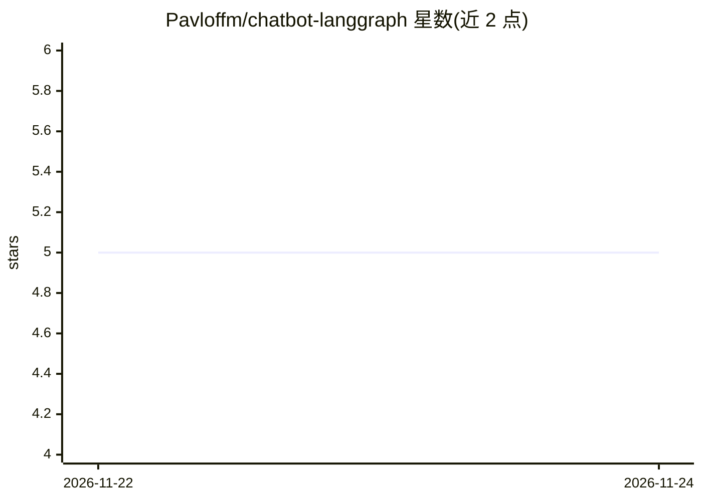

# Pavloffm/chatbot-langgraph

⭐ 5 · TypeScript · 推送 2026-11-21 · [GitHub](https://github.com/Pavloffm/chatbot-langgraph) · [官网](https://mykhailo-pavlov.vercel.app/en/projects/ai-knowledge-assistant) · 个人维护

**本地优先 AI 聊天应用：持久会话、流式回复、可选联网搜索**

前后端分离的本地 AI 聊天原型：React 前端负责聊天界面，FastAPI 后端通过流式 NDJSON 输出回复；LangGraph 结合 PostgreSQL checkpointer 保存会话状态，重启后可继续对话；PostgreSQL 存储会话标题与归属。可选 SearXNG 联网搜索，由具备工具调用能力的模型决定是否触发，单次最多返回五条结果并附带来源链接。使用 Clerk 做服务端会话校验与归属检查。运行需 Python 3.12、uv、Node.js 24、Docker、Ollama 与 Clerk 开发实例；README 明确说明未配置公网部署。

## 筛选速览

| 维度 | 判定 | 备注 |
|---|---|---|
| AI 角色 | `ai-native` | 本体是模型或模型工具 |
| 许可风险 | `none` | — |
| 部署形态 | `self-host` | docker 或自建部署 |
| 模型依赖 | local-ok | 支持本地模型 |
| 硬件要求 | — | 无带数字的原话,不猜 |
| 安装摩擦 | `low` | 无编译、无系统依赖或容器化 |
| 成熟度 | — | 结构信号不足 |

## 能力要点

- LangGraph checkpoints 使会话状态在重启后保留
- 回复流式生成，可选 SearXNG 搜索并展示进度与来源链接
- FastAPI 服务端校验 Clerk 令牌并检查会话归属
- 按会话的 advisory lock 防止并发生成

## 适用场景

- 本地运行一个可持久保存对话历史的 AI 聊天助手
- 需要回复附来源链接的联网问答
- 研究 LangGraph + FastAPI 全栈聊天的工程结构

## 场景标签

`聊天机器人` · 领域:对话与助手

## 证据(README 行号)

> L3: **A local AI assistant with persistent conversations, streamed replies, and
> L5: FastAPI, LangGraph, Ollama, and PostgreSQL handle the backend and message state.
> L38:                               ├── Ollama (local model)

## 星数曲线

2026-11-22 5 → 2026-11-24 5（+0）

---
*卡片 v1 · prompt 1.4 · 生成 2026-11-22 · 置信度 high · 依据 README sha `44e7c13d9805` · [字段定义](../../DATASET.md)*
