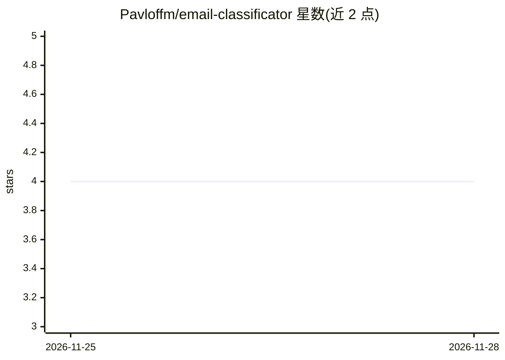

# Pavloffm/email-classificator

⭐ 4 · Python · 推送 2026-11-25 · [GitHub](https://github.com/Pavloffm/email-classificator) · 个人维护

**用本地 LLM 将 Gmail 未读邮件分类打标的工具**

通过 Gmail API 拉取最近 14 天未读邮件，调用本地 Ollama 模型为每封邮件选择四类标签（is_spam/need_reply/to_read/can_skip）并回写 Gmail 标签；不发送回复、不删除或标记已读。需 Python 3.12+ 与 uv，配置 Google OAuth 桌面客户端凭证；支持环境变量配置模型与端点，可定时调度，也提供 Docker Compose 部署；附带数据集导出与准确率评估脚本。

## 筛选速览

| 维度 | 判定 | 备注 |
|---|---|---|
| AI 角色 | `ai-native` | 本体是模型或模型工具 |
| 许可风险 | `none` | — |
| 部署形态 | `self-host` | docker 或自建部署 |
| 模型依赖 | local-ok | 支持本地模型 |
| 硬件要求 | — | 无带数字的原话,不猜 |
| 安装摩擦 | `low` | 无编译、无系统依赖或容器化 |
| 成熟度 | — | 结构信号不足 |

## 能力要点

- 本地 LLM 分类，邮件内容仅发送至配置的 Ollama 端点
- 四类标签体系：垃圾、需回复、待读、可跳过
- 定时调度运行，带锁防止重叠
- 内置自建评估集与准确率/召回对比脚本

## 适用场景

- 自动整理 Gmail 未读邮件为待办列表
- 本地运行 LLM 处理邮件以避免云端 API
- 定时批量分类并人工复核标签

## 场景标签

`工作流自动化` · 领域:效率与自动化

## 证据(README 行号)

> L3: Turn unread Gmail messages into a labeled to-do list: reply, read, skip, or flag as spam. Powered by a local LLM thr
> L12: already have one of its labels. It normalizes their content, asks Ollama to choose
> L22: Classification does not send replies, delete messages, or mark them as read.

## 星数曲线

2026-11-25 4 → 2026-11-28 4（+0）

---
*卡片 v1 · prompt 1.4 · 生成 2026-11-25 · 置信度 high · 依据 README sha `a00f7f0128fd` · [字段定义](../../DATASET.md)*
