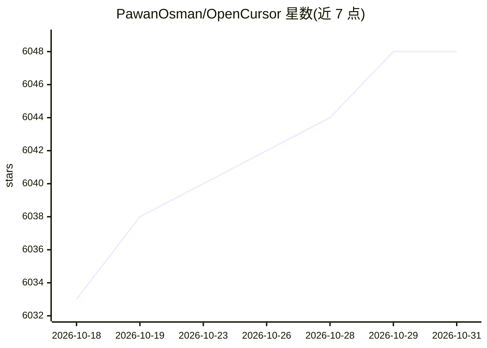

# PawanOsman/OpenCursor

⭐ 6,048 · TypeScript · MIT · 推送 2026-10-26 · [GitHub](https://github.com/PawanOsman/OpenCursor) · [官网](https://marketplace.visualstudio.com/items?itemName=pkrd.ocursor) · 个人维护

**开源的 VS Code AI 编程 agent 扩展，自带模型与变更审查**

VS Code 扩展形式的 AI 编程 agent：在工作区内提供对话、代码探索、文件编辑、终端命令与变更审查（逐 hunk 审阅、Keep All/Undo All）。模型接入支持账号登录（Claude Code、Copilot 等）、API key（OpenAI、Anthropic、DeepSeek 等）、自定义 OpenAI/Anthropic 兼容端点，以及 Ollama 与 llama.cpp 本地推理；本地模式配设备端嵌入索引做语义检索。支持 MCP、钩子、子代理、Git worktree 与 Docker 执行等扩展机制。对话与密钥数据本地存储，需 VS Code 1.96+，MIT 许可。

## 筛选速览

| 维度 | 判定 | 备注 |
|---|---|---|
| AI 角色 | `ai-native` | 本体是模型或模型工具 |
| 许可风险 | `permissive` | MIT |
| 部署形态 | `library` | 以包/库形式分发 |
| 模型依赖 | local-ok | 支持本地模型 |
| 硬件要求 | — | 无带数字的原话,不猜 |
| 安装摩擦 | `low` | 无编译、无系统依赖或容器化 |
| 成熟度 | — | 结构信号不足 |

## 能力要点

- Agent/Ask/Plan/Project/Multitask 五种模式，Agent 按配置权限执行变更
- 多提供商接入：账号、API key、自定义端点、Ollama 与 llama.cpp 本地推理
- 本地嵌入索引 + 词法匹配的语义代码检索，可离线工作
- 变更逐 hunk 审阅与 Keep/Undo，MCP 与子代理支持

## 适用场景

- 在 VS Code 内用自带 API key 或本地模型进行 AI 辅助编程
- 让 agent 在工作区内读改文件、跑命令并人工审查结果
- 离线/本地环境下用 llama.cpp 或 Ollama 做推理与代码检索

## 场景标签

`编码 Agent` `代码审查` · 领域:编码与开发

## 证据(README 行号)

> L3: **An open-source AI coding agent for VS Code. Bring your models, work in your workspace, and stay in control of the 
> L13: OpenCursor brings conversation, code exploration, file edits, terminal commands, and change review into your editor
> L19: 3. **Choose a model and start a conversation.** Enable the models you want in **Models**, select one in the compose

## 星数曲线

2026-10-18 6,033 → 2026-10-31 6,048（+15）

---
*卡片 v1 · prompt 1.4 · 生成 2026-10-20 · 置信度 mid · 依据 README sha `2e7697586185` · [字段定义](../../DATASET.md)*
