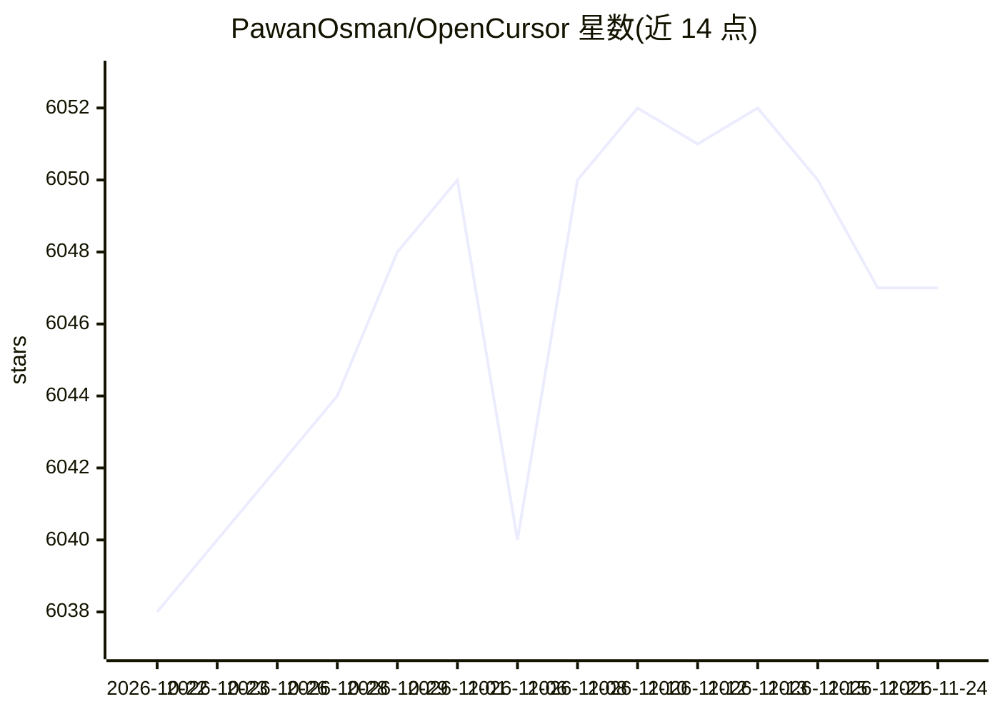

# PawanOsman/OpenCursor

⭐ 6,048 · TypeScript · MIT · 推送 2026-10-26 · [GitHub](https://github.com/PawanOsman/OpenCursor) · [官网](https://marketplace.visualstudio.com/items?itemName=pkrd.ocursor) · 个人维护

**VS Code 开源 AI 编码 agent 扩展：多模型接入的代理式编程助手**

以 VS Code 扩展形式提供的 AI 编码 agent：在工作区内提供对话、文件读写与编辑、代码搜索、终端命令执行与变更审查，支持 Agent/Ask/Plan/Project/Multitask 等模式及权限控制。模型接入覆盖账户登录、API key、自定义兼容端点与本地推理（Ollama、llama.cpp/GGUF），支持多凭据负载均衡与故障转移；本地嵌入索引提供语义代码检索与文档索引。安装方式为 VS Code Marketplace 或 .vsix，源码构建需 Node.js 22 与 pnpm。

## 筛选速览

| 维度 | 判定 | 备注 |
|---|---|---|
| AI 角色 | `ai-native` | 本体是模型或模型工具 |
| 许可风险 | `permissive` | MIT |
| 部署形态 | `library` | 以包/库形式分发 |
| 模型依赖 | local-ok | 支持本地模型 |
| 硬件要求 | — | 无带数字的原话,不猜 |
| 安装摩擦 | `low` | 无编译、无系统依赖或容器化 |
| 成熟度 | — | 结构信号不足 |

## 能力要点

- 多模型接入：账户登录、API provider、OpenAI/Anthropic 兼容端点与本地模型
- 本地推理：管理 llama.cpp 运行时与 GGUF 模型、连接 Ollama，可离线工作
- 本地嵌入语义检索，工作区文件与文档均建为可搜索索引
- 变更审查流程：逐 hunk 检查、Keep All / Undo All、权限控制

## 适用场景

- 在 VS Code 内用自有 API key 或本地模型进行代理式编码
- 离线环境下用本地模型完成代码编辑与语义搜索
- 多 provider/多凭据间做负载均衡与故障转移

## 场景标签

`编码 Agent` · 领域:编码与开发

## 证据(README 行号)

> L3: **An open-source AI coding agent for VS Code. Bring your models, work in your workspace, and stay in control of the 
> L13: OpenCursor brings conversation, code exploration, file edits, terminal commands, and change review into your editor
> L46: |**Local models**|Ollama and llama.cpp|Connect to Ollama or manage a llama.cpp runtime and GGUF models.|

## 星数曲线

2026-10-22 6,038 → 2026-11-24 6,047（+9）

---
*卡片 v1 · prompt 1.4 · 生成 2026-11-22 · 置信度 mid · 依据 README sha `e740f058c19e` · [字段定义](../../DATASET.md)*
