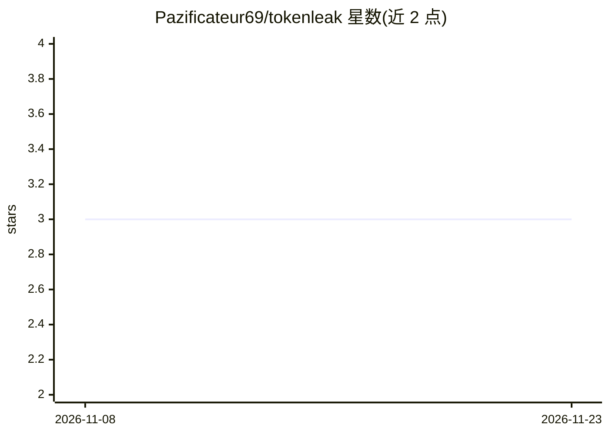

# Pazificateur69/tokenleak

⭐ 3 · Python · MIT · 推送 2026-10-13 · [GitHub](https://github.com/Pazificateur69/tokenleak) · [官网](https://pazificateur69.github.io/tokenleak/) · 个人维护 · 中文 README

**本地只读审计编码代理的 token 消耗并给出上下文瘦身规则**

tokenleak 是一个本地 CLI 与 agent 技能：读取本机 Claude Code 与 Codex 的会话记录，统计上下文、缓存写入与输出各占成本的比例，定位超大读取、噪声日志、重复调用等泄漏点并按 context tax 估价。附带的规则技能（约 770 token）注入会话，约束代理只读取所需内容；插件模式还内置读取守卫，将大文件整读替换为大纲。Python 3.8+ 标准库实现，零依赖、只读、不外发数据。作者报告其规则在 Sonnet 5 上 80 次 A/B 运行中降低 32% 成本，短会话场景压缩可能反而增加成本，工具仅在自身会话显示有收益时才建议设置。

## 筛选速览

| 维度 | 判定 | 备注 |
|---|---|---|
| AI 角色 | `ai-ecosystem` | LLM/agent 周边工具 |
| 许可风险 | `permissive` | MIT |
| 部署形态 | `library` | 以包/库形式分发 |
| 模型依赖 | — | README 未给出锁定关系 |
| 硬件要求 | — | 无带数字的原话,不猜 |
| 安装摩擦 | `low` | 无编译、无系统依赖或容器化 |
| 成熟度 | — | 结构信号不足 |

## 能力要点

- 读取本地 ~/.claude/projects 与 ~/.codex/sessions 的只读审计，零依赖
- 识别 8 类泄漏（big-read、re-read、serial-call 等）并按 context tax 估价
- autoCompactWindow 回放模拟，预测提前压缩的节省金额
- 以 Claude Code/Codex 插件、Agent Skills（npx）或指令文件追加多种方式安装

## 适用场景

- 审计自己 Claude Code/Codex 会话的 token 去向与成本构成
- 为长上下文会话推荐并写入 autoCompactWindow 设置
- 为具体项目生成贴合实际泄漏的 CLAUDE.md/AGENTS.md 规则块
- 状态栏实时显示当前会话泄漏分数

## 场景标签

`LLM 可观测性` · 领域:评测与运维

## 证据(README 行号)

> L47: 2. **An audit** that reads *your own* Claude Code and Codex transcripts and shows where the tokens actually went: e
> L109: Or install the CLI from PyPI: `uvx tokenleak` (or `pipx install tokenleak`, or `pip install tokenleak`), or run it

## 星数曲线

2026-11-08 3 → 2026-11-23 3（+0）

---
*卡片 v1 · prompt 1.4 · 生成 2026-11-22 · 置信度 high · 依据 README sha `cbd561f06303` · [字段定义](../../DATASET.md)*
