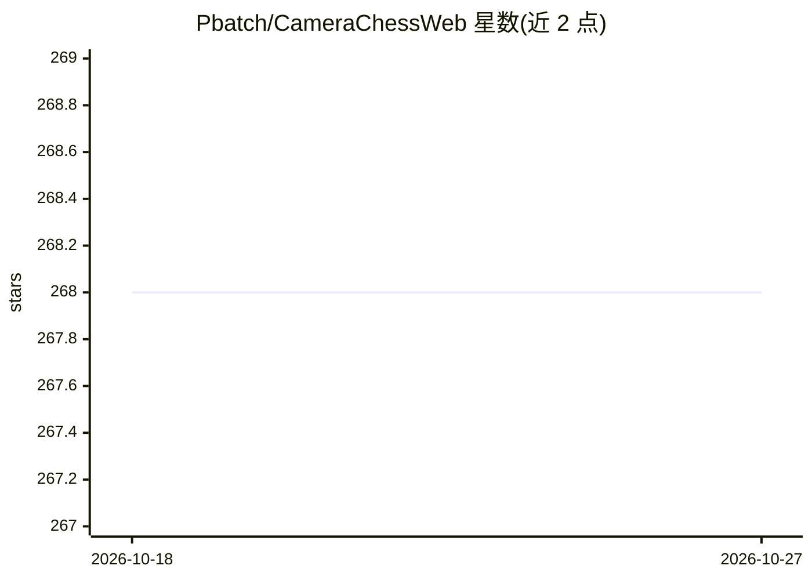

# Pbatch/CameraChessWeb

⭐ 268 · TypeScript · AGPL-3.0 · 推送 2026-10-26 · [GitHub](https://github.com/Pbatch/CameraChessWeb) · [官网](https://www.chesscam.net) · 个人维护

**用手机摄像头直播记录国际象棋对局并上传 PGN 到 Lichess**

名为 ChessCam 的 Web 应用，用手机摄像头替代实体国际象棋电子棋盘（eBoard）：通过计算机视觉模型（LeYOLO）识别棋子与棋盘角点，实时记录对局并生成 PGN 上传至 Lichess。README 提供棋子识别与角点检测两个任务的 ONNX/pt 模型下载、YOLOv5 格式训练数据、Weights & Biases 训练报告及 Google Colab 训练/导出脚本。项目声明处于活跃开发中，可能存在小问题，用户可通过 Discord 反馈。

## 筛选速览

| 维度 | 判定 | 备注 |
|---|---|---|
| AI 角色 | `ai-native` | 本体是模型或模型工具 |
| 许可风险 | `viral` | AGPL-3.0 |
| 部署形态 | `None` |  |
| 模型依赖 | — | README 未给出锁定关系 |
| 硬件要求 | — | 无带数字的原话,不猜 |
| 安装摩擦 | `low` | 无编译、无系统依赖或容器化 |
| 成熟度 | `idea` | |

## 能力要点

- 摄像头棋盘识别替代实体电子棋盘，记录对局并上传 PGN 至 Lichess
- 提供棋子与棋盘角点检测的 LeYOLO 模型（ONNX/pt 格式）
- 附带 YOLOv5 格式训练数据与 Weights & Biases 训练报告
- 提供 Google Colab 的 LeYOLO 训练与 ONNX/TFJS 导出脚本

## 适用场景

- 没有电子棋盘时用手机摄像头直播记录实体棋局
- 将对局 PGN 同步到 Lichess 供复盘与分享
- 复用或再训练棋子/棋盘角点检测模型

## 场景标签

`目标检测` · 领域:感知与多模态

## 证据(README 行号)

> L9: Replace Chess eBoards with your phone camera using ChessCam (https://www.chesscam.net).
> L29: |480M_leyolo_pieces.onnx|LeYOLO ONNX model|https://drive.google.com/file/d/1-80xp_nly9i6s3o0mF0mU9OZGEzUAlGj/view?u
> L38: |480L_leyolo_xcorners.onnx|LeYOLO ONNX model|https://drive.google.com/file/d/1-2wodbiXag9UQ44e2AYAmoRN6jVpxy83/view

## 星数曲线

2026-10-18 268 → 2026-10-27 268（+0）

---
*卡片 v1 · prompt 1.4 · 生成 2026-10-22 · 置信度 high · 依据 README sha `df015e4541b7` · [字段定义](../../DATASET.md)*
