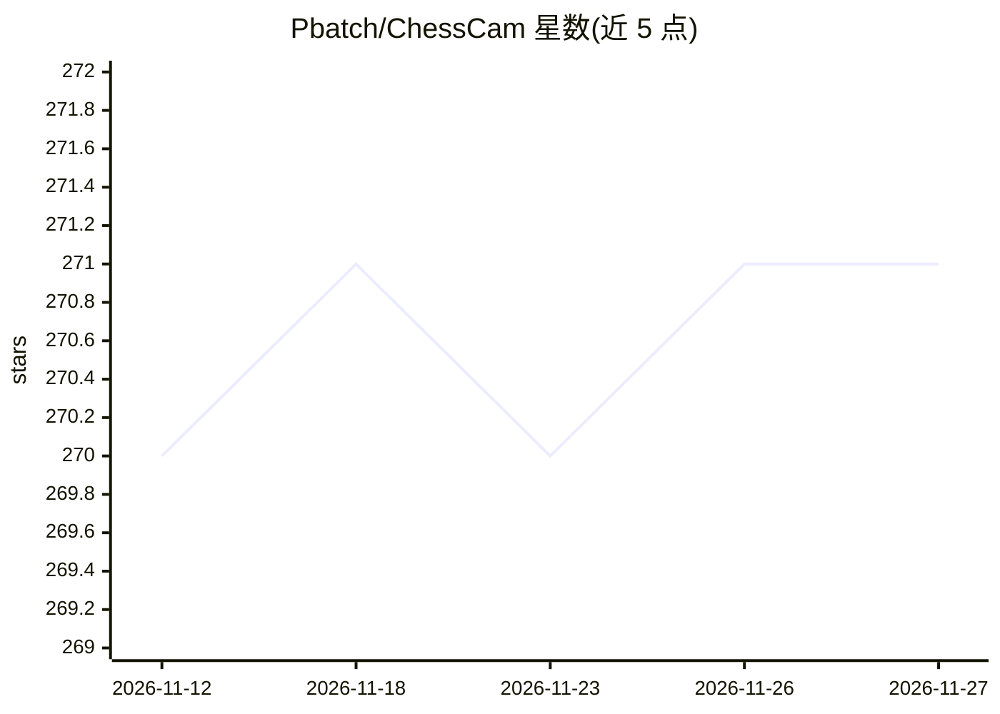

# Pbatch/ChessCam

⭐ 271 · TypeScript · AGPL-3.0 · 推送 2026-11-22 · [GitHub](https://github.com/Pbatch/ChessCam) · [官网](https://www.chesscam.net) · 组织维护

**用手机摄像头替代国际象棋电子棋盘、直播记谱的应用**

运行在浏览器中的应用，将摄像头对准实体棋盘，随对局实时记录着法并生成 PGN；支持将对局视频转为 PGN、在实体棋盘上进行 Lichess 对局、边下边向 Lichess 直播，并可将棋局上传到 Lichess 或保存为 PGN 文件。首次访问后可离线使用。主题标签显示其采用计算机视觉与机器学习（dinov3、LiteRT）实现棋盘识别，面向拥有实体棋盘的棋手。README 自述处于活跃开发中，可能存在小问题。

## 筛选速览

| 维度 | 判定 | 备注 |
|---|---|---|
| AI 角色 | `ai-native` | 本体是模型或模型工具 |
| 许可风险 | `viral` | AGPL-3.0 |
| 部署形态 | `None` |  |
| 模型依赖 | — | README 未给出锁定关系 |
| 硬件要求 | — | 无带数字的原话,不猜 |
| 安装摩擦 | `low` | 无编译、无系统依赖或容器化 |
| 成熟度 | `idea` | |

## 能力要点

- 摄像头实时记录实体棋盘着法并生成 PGN
- 将对局视频转为 PGN
- 支持在实体棋盘上打 Lichess 对局并向 Lichess 直播
- 浏览器运行，首次访问后可离线使用

## 适用场景

- 没有电子棋盘时用手机记录实体对局
- 把已下的对局视频整理成 PGN 存档
- 在实体棋盘上体验线上 Lichess 对局并直播

## 场景标签

`图像视频处理` · 领域:感知与多模态

## 证据(README 行号)

> L9: Replace Chess eBoards with your phone camera using ChessCam (https://www.chesscam.net).
> L17: * **Record**: point your camera at the board and the moves are recorded as you play

## 星数曲线

2026-11-12 270 → 2026-11-27 271（+1）

---
*卡片 v1 · prompt 1.4 · 生成 2026-11-17 · 置信度 mid · 依据 README sha `e9a2cba81d83` · [字段定义](../../DATASET.md)*
