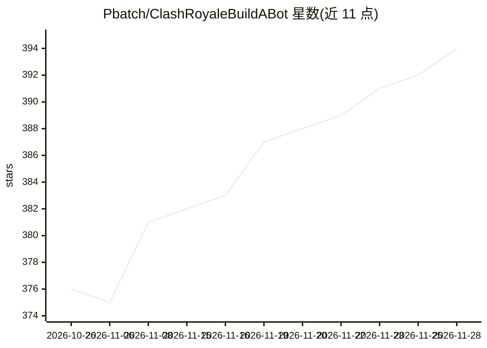

# Pbatch/ClashRoyaleBuildABot

⭐ 394 · Python · MIT · 推送 2026-11-27 · [GitHub](https://github.com/Pbatch/ClashRoyaleBuildABot) · 组织维护

**为玩 Clash Royale 制作机器人的开发平台**

提供创建自动操作 Clash Royale 游戏的机器人平台，README 称其包含一个状态生成器，返回详细的局面信息，主题标签显示涉及计算机视觉与机器学习（yolov10）。使用前需准备 Android 设备，安装 uv 与 Git，再安装配置机器人；要求 Python 3.12。README 声明仅供教育与研究目的，禁止用于 Supercell 的 Clash Royale 游戏本身，项目处于活跃开发中，问题反馈通过 Discord。

## 筛选速览

| 维度 | 判定 | 备注 |
|---|---|---|
| AI 角色 | `ai-native` | 本体是模型或模型工具 |
| 许可风险 | `permissive` | MIT |
| 部署形态 | `None` |  |
| 模型依赖 | — | README 未给出锁定关系 |
| 硬件要求 | — | 无带数字的原话,不猜 |
| 安装摩擦 | `low` | 无编译、无系统依赖或容器化 |
| 成熟度 | `idea` | |

## 能力要点

- 提供游戏局面状态生成器，返回详细信息
- 基于 Android 设备运行（主题标签含 adb、bluestacks）
- 使用 yolov10 进行计算机视觉识别（主题标签）
- 遵循 all-contributors 规范

## 适用场景

- 搭建机器人实验游戏操作自动化
- 计算机视觉识别游戏界面的学习项目
- 按 README 声明用于教育与研究目的

## 场景标签

`GUI 自动化` `目标检测` · 领域:效率与自动化

## 证据(README 行号)

> L8: Welcome to Clash Royale Build-A-Bot! This project provides an advanced state generator that accurately returns detai
> L20: To set up the bot, follow the Quick Start: set up your Android device, install uv and Git, then install and configu

## 星数曲线

2026-10-26 376 → 2026-11-28 394（+18）

---
*卡片 v1 · prompt 1.4 · 生成 2026-11-27 · 置信度 mid · 依据 README sha `1b196598a86f` · [字段定义](../../DATASET.md)*
