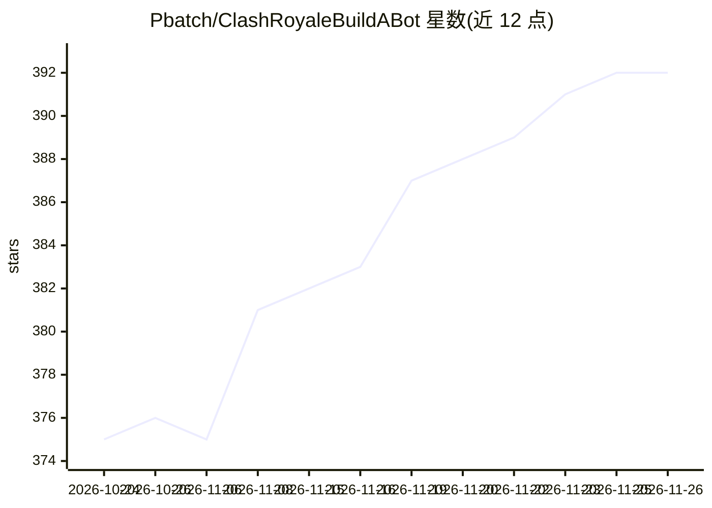

# Pbatch/ClashRoyaleBuildABot

⭐ 392 · Python · MIT · 推送 2026-11-25 · [GitHub](https://github.com/Pbatch/ClashRoyaleBuildABot) · 个人维护

**为开发自动玩 Clash Royale 机器人提供状态生成与平台**

面向游戏自动化教学与研究的开源平台：通过模拟器运行 Clash Royale，用计算机视觉（YOLO 模型检测）读取游戏画面状态，据此驱动机器人执行出牌等操作。安装流程为配置安卓模拟器、用 uv 安装 Python 环境、再按指南配置机器人本体；更新需手动 git pull 后 uv sync，配置保存在 config.yaml。README 明确仅供教育与研究用途，禁止用于实际 Supercell 游戏。功能列表尚在完善中，正在推进 HP 检测、单位计数、跟踪算法等方向。

## 筛选速览

| 维度 | 判定 | 备注 |
|---|---|---|
| AI 角色 | `ai-native` | 本体是模型或模型工具 |
| 许可风险 | `permissive` | MIT |
| 部署形态 | `None` |  |
| 模型依赖 | — | README 未给出锁定关系 |
| 硬件要求 | — | 无带数字的原话,不猜 |
| 安装摩擦 | `low` | 无编译、无系统依赖或容器化 |
| 成熟度 | `idea` | |

## 能力要点

- 基于计算机视觉/YOLO 的游戏状态检测生成器
- 通过 ADB 与模拟器（BlueStacks）控制游戏操作
- 提供 GUI 与配置文件（config.yaml）管理设置
- 通过 git pull + uv sync 手动更新

## 适用场景

- 学习计算机视觉与游戏自动化的实现方式
- 在模拟器环境中开展游戏 AI 研究实验
- 为教育目的搭建并调试自己的游戏机器人

## 场景标签

 · 领域:游戏自动化/计算机视觉

## 证据(README 行号)

> L8: Welcome to Clash Royale Build-A-Bot! This project provides an advanced state generator that accurately returns detai
> L36: Our bot is equipped with a variety of functionalities designed for educational and research purposes. We will be up

## 星数曲线

2026-10-24 375 → 2026-11-26 392（+17）

---
*卡片 v1 · prompt 1.4 · 生成 2026-11-25 · 置信度 mid · 依据 README sha `5abfca6dba0c` · [字段定义](../../DATASET.md)*
