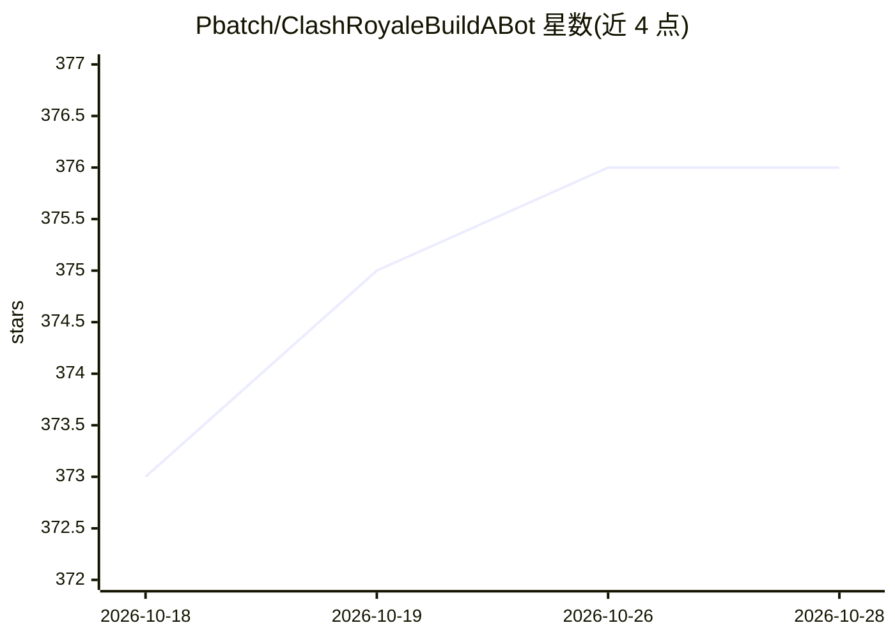

# Pbatch/ClashRoyaleBuildABot

⭐ 376 · Python · MIT · 推送 2026-07-24 · [GitHub](https://github.com/Pbatch/ClashRoyaleBuildABot) · 组织维护

**用计算机视觉生成游戏状态、创建 Clash Royale 游戏机器人**

面向教育与研究的 Clash Royale 游戏机器人开发平台：通过模拟器（如 BlueStacks）运行游戏，用视觉技术（主题含 YOLOv10、computer-vision）生成游戏状态信息，供机器人决策使用。安装流程分三步：配置模拟器、安装 uv/Python/Git、按指南安装机器人本体；提供 GUI。README 声明仅供教育与研究用途，明确禁止与 Supercell 的 Clash Royale 游戏联用，否则可能违反服务条款。项目处于活跃开发中。

## 筛选速览

| 维度 | 判定 | 备注 |
|---|---|---|
| AI 角色 | `ai-native` | 本体是模型或模型工具 |
| 许可风险 | `permissive` | MIT |
| 部署形态 | `None` |  |
| 模型依赖 | — | README 未给出锁定关系 |
| 硬件要求 | — | 无带数字的原话,不猜 |
| 安装摩擦 | `low` | 无编译、无系统依赖或容器化 |
| 成熟度 | `idea` | |

## 能力要点

- 基于视觉的游戏状态生成器，主题含 YOLOv10/computer-vision
- 提供 GUI 界面
- 三步安装流程（模拟器、uv/Python/Git、机器人本体）
- 计划功能含宝箱开启、卡组切换、跟踪算法等

## 适用场景

- 教育场景下学习游戏机器人开发
- 研究基于视觉的游戏状态识别与决策
- 参考其目标检测与跟踪实现方式

## 场景标签

`目标检测` `GUI 自动化` · 领域:效率与自动化

## 证据(README 行号)

> L8: Welcome to Clash Royale Build-A-Bot! This project provides an advanced state generator that accurately returns detai
> L22: 1. **Install and Configure the Emulator:** Follow our Emulator Setup Guide.
> L48: This open-source bot is intended solely for **educational and research purposes**. It is not affiliated with, autho

## 星数曲线

2026-10-18 373 → 2026-10-28 376（+3）

---
*卡片 v1 · prompt 1.4 · 生成 2026-10-21 · 置信度 mid · 依据 README sha `46b2e24813e0` · [字段定义](../../DATASET.md)*
