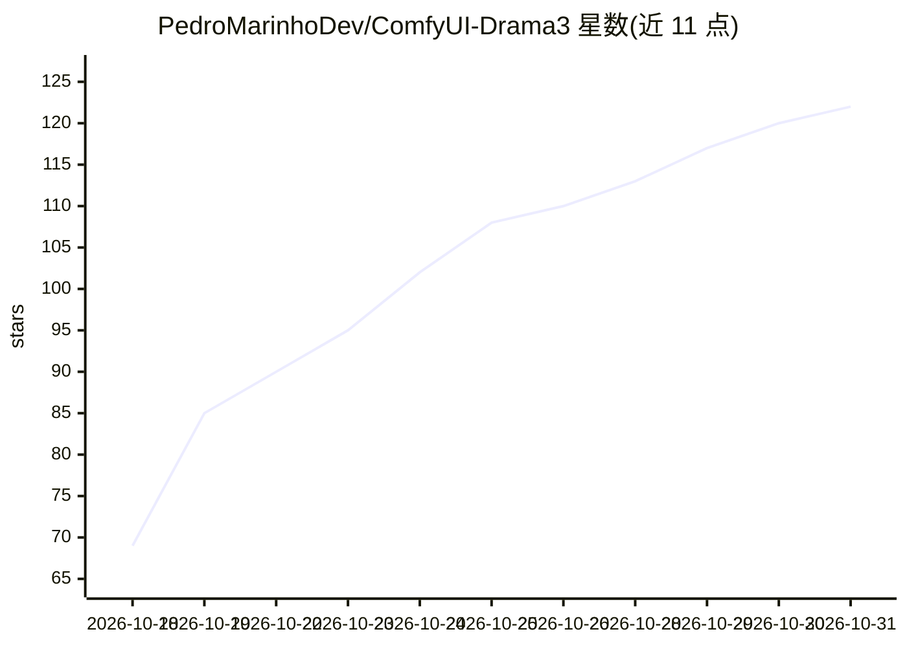

# PedroMarinhoDev/ComfyUI-Drama3

⭐ 122 · Python · GPL-3.0 · 推送 2026-10-25 · [GitHub](https://github.com/PedroMarinhoDev/ComfyUI-Drama3) · [官网](https://pedromarinhodev.github.io/ComfyUI-Drama3/) · 个人维护

**在 ComfyUI 中本地运行 Fish Audio Drama 3 语音合成与 Qwen3 转写的节点包**

ComfyUI 自定义节点集：将 35B 的 Fish Audio Drama 3 文本转语音模型以原生节点方式运行，支持数秒音频克隆声音、最多 16 个说话人的对话文本、[laughs]/[whispers] 等行内提示标签与自然语言导演注记；通过路由专家驻留系统 RAM、GPU 缓存激活专家的方式将显存门槛降至 8 GB，并提供专用 CUDA 内核加速。附带 Qwen3-ASR（1.7B/0.6B）节点用于生成语音转录与逐词对齐。安装方式为 git clone 至 custom_nodes，另需从 Hugging Face 下载 24.6–38.6 GB 模型文件。

## 筛选速览

| 维度 | 判定 | 备注 |
|---|---|---|
| AI 角色 | `ai-native` | 本体是模型或模型工具 |
| 许可风险 | `viral` | GPL-3.0 |
| 部署形态 | `library` | 以包/库形式分发 |
| 模型依赖 | — | README 未给出锁定关系 |
| 硬件要求 | `gpu-8g` | |
| 安装摩擦 | `medium` | 含编译或系统依赖之一 |
| 成熟度 | — | 结构信号不足 |

## 能力要点

- 声音克隆（数秒音频+转录文本即可编码保存复用）与最多 16 说话人对话生成
- 专家驻留 RAM + VRAM 缓存机制，8 GB 显存即可运行
- 自带 Qwen3-ASR（30 语言）与 ForcedAligner 逐词对齐节点
- 提供 Drama 3 Editor 图形编辑器（剪切、静音调整、逐词字幕、多音轨）

## 适用场景

- 在 ComfyUI 工作流中做多说话人有声对话/播客内容生成
- 用几秒参考音频克隆合成语音并保存复用
- 为音频素材生成 30 语言转录与逐词时间轴

## 场景标签

`语音合成` `语音识别` · 领域:内容生成

## 证据(README 行号)

> L13: Run **Fish Audio Drama 3**, a 35B text-to-speech model for voice cloning,
> L16: GPU keeps a cache of the ones in use. The pack also brings a native **Qwen3-ASR** that writes a voice clip's

## 星数曲线

2026-10-18 69 → 2026-10-31 122（+53）

---
*卡片 v1 · prompt 1.4 · 生成 2026-10-23 · 置信度 mid · 依据 README sha `fd04aff68091` · [字段定义](../../DATASET.md)*
