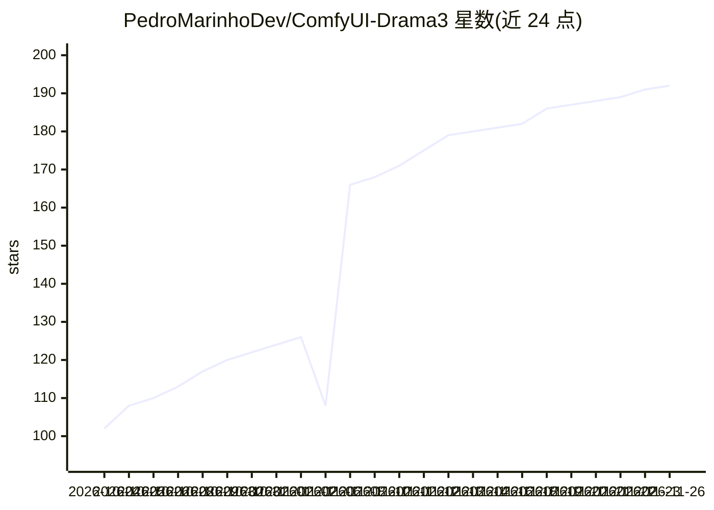

# PedroMarinhoDev/ComfyUI-Drama3

⭐ 192 · Python · GPL-3.0 · 推送 2026-11-13 · [GitHub](https://github.com/PedroMarinhoDev/ComfyUI-Drama3) · [官网](https://pedromarinhodev.github.io/ComfyUI-Drama3/) · 个人维护

**在 ComfyUI 内本地运行 Fish Audio Drama 3 语音合成的节点包**

一组 ComfyUI 自定义节点，将 Fish Audio Drama 3（35B 文本转语音模型）以原生方式接入 ComfyUI 工作流：支持从数秒参考音频克隆声音、单脚本最多 16 个说话人、行内表演指示（如 [sighs]、[whispers]）与导演注记，另集成 Qwen3-ASR 为参考音频写转录。提供多种量化权重文件以适配 24/12/8 GB 显卡与不同系统内存，节点经 ComfyUI-Manager 或 comfy node install 安装，无需 pip 依赖。

## 筛选速览

| 维度 | 判定 | 备注 |
|---|---|---|
| AI 角色 | `ai-native` | 本体是模型或模型工具 |
| 许可风险 | `viral` | GPL-3.0 |
| 部署形态 | `library` | 以包/库形式分发 |
| 模型依赖 | — | README 未给出锁定关系 |
| 硬件要求 | — | 无带数字的原话,不猜 |
| 安装摩擦 | `medium` | 含编译或系统依赖之一 |
| 成熟度 | — | 结构信号不足 |

## 能力要点

- 数秒参考音频克隆声音，支持保存/复用编码后的声音文件（数 KB）
- 单脚本最多 16 个说话人，多种对话生成模式（逐行/逐说话人/合声）
- 四种量化权重文件覆盖 24 GB 至 8 GB 显卡与不同内存配置
- 内置 Qwen3-ASR 为参考音频生成转录，与裁剪对齐

## 适用场景

- 在 ComfyUI 工作流里生成带表演指示的有声对白/播客
- 用几秒参考音频克隆声音并批量生成语音
- 8 GB 显卡本地运行大规模 TTS 模型
- 为语音片段自动生成转录并做对齐检查

## 场景标签

`语音合成` `语音识别` `模型量化` · 领域:内容生成

## 证据(README 行号)

> L3: **ComfyUI-Drama3** runs Fish Audio Drama 3, a 35B text-to-speech model,
> L4: natively in ComfyUI. Clone a voice from a few seconds of audio, cast up to 16 speakers in one script and write
> L5: directions such as `[sighs]` or `[whispers]` where they should land. It runs on NVIDIA cards from 8 GB, with nothing

## 星数曲线

2026-10-24 102 → 2026-11-26 192（+90）

---
*卡片 v1 · prompt 1.4 · 生成 2026-11-26 · 置信度 mid · 依据 README sha `e50bba76c6df` · [字段定义](../../DATASET.md)*
